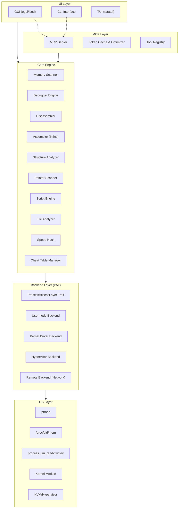
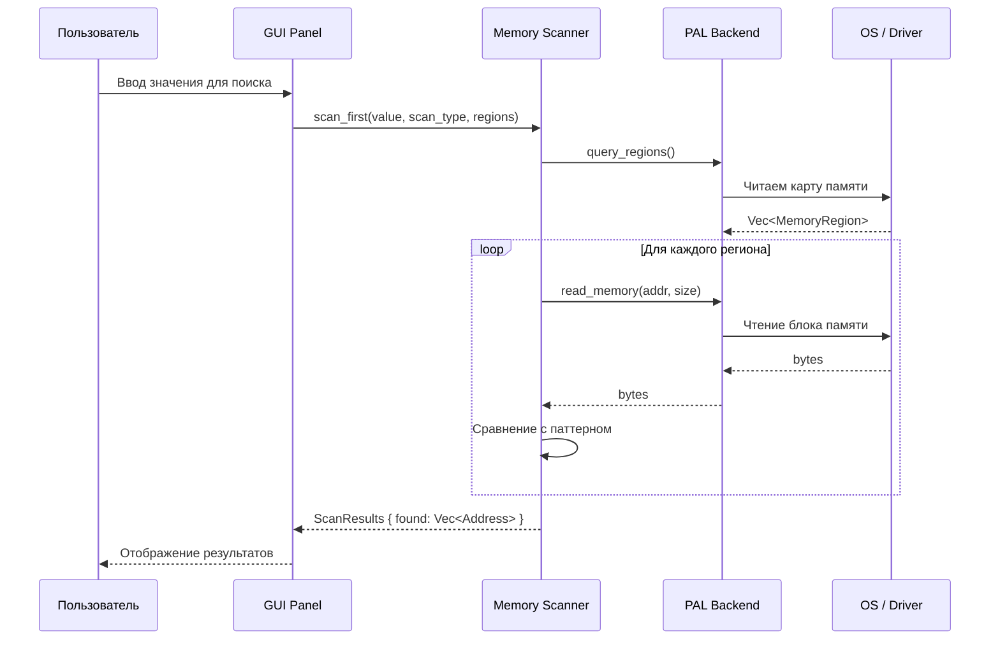
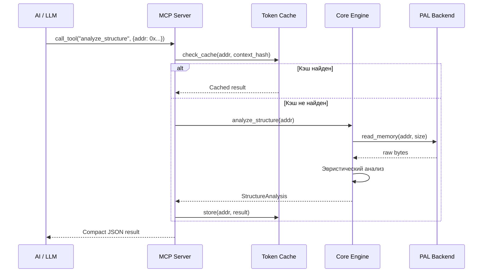

# ️ Архитектура Engine+

## Обзор

Engine+ построен по принципу **слоёной архитектуры** с чёткими границами между компонентами.
Каждый слой общается только с соседними через определённые trait-ы и API.

---

## Высокоуровневая архитектура



---

## Слои системы

### 1. UI Layer — Пользовательский интерфейс

Три режима интерфейса, работающих с единым Core API:

| Режим | Технология | Описание |
|-------|-----------|----------|
| **GUI** | `egui` или `iced` | Основной интерфейс в стиле IDE |
| **CLI** | `clap` | Командная строка для автоматизации |
| **TUI** | `ratatui` | Текстовый интерфейс для терминала |

### 2. MCP Layer — AI интеграция

- **MCP Server** — полноценный MCP-сервер с tools для всех операций
- **Token Cache** — кэширование результатов анализа, дедупликация
- **Tool Registry** — регистрация и маршрутизация MCP-инструментов

### 3. Core Engine — Ядро

Центральный модуль, содержащий всю бизнес-логику:

| Модуль | Описание |
|--------|----------|
| `Scanner` | Поиск значений в памяти (first scan, next scan, undo) |
| `Debugger` | Точки останова, stepping, watch |
| `Disassembler` | Дизассемблирование x86/x64/ARM |
| `Assembler` | Ассемблирование инструкций в байты |
| `StructAnalyzer` | Анализ и рекурсивное построение структур |
| `PointerScanner` | Поиск цепочек указателей |
| `ScriptEngine` | Lua/WASM скрипты |
| `FileAnalyzer` | Статический анализ PE/ELF файлов |
| `SpeedHack` | Ускорение/замедление времени |
| `TableManager` | Управление чит-таблицами |

### 4. Backend Layer (PAL) — Уровень доступа к процессу

**Process Access Layer (PAL)** — ключевая абстракция, позволяющая менять способ
взаимодействия с целевым процессом без изменения остального кода.

```rust
/// Основной trait для любого backend-а доступа к процессу
pub trait ProcessAccessLayer: Send + Sync {
    /// Присоединиться к процессу
    fn attach(&mut self, pid: u32) -> Result<()>;
    
    /// Отсоединиться
    fn detach(&mut self) -> Result<()>;
    
    /// Прочитать память
    fn read_memory(&self, address: u64, size: usize) -> Result<Vec<u8>>;
    
    /// Записать память
    fn write_memory(&self, address: u64, data: &[u8]) -> Result<()>;
    
    /// Получить список регионов памяти
    fn query_regions(&self) -> Result<Vec<MemoryRegion>>;
    
    /// Получить список модулей
    fn enumerate_modules(&self) -> Result<Vec<Module>>;
    
    /// Получить список потоков
    fn enumerate_threads(&self) -> Result<Vec<Thread>>;
    
    /// Установить breakpoint
    fn set_breakpoint(&mut self, address: u64, bp_type: BreakpointType) -> Result<BreakpointId>;
    
    /// Удалить breakpoint
    fn remove_breakpoint(&mut self, id: BreakpointId) -> Result<()>;
    
    /// Защитить регион памяти
    fn protect_memory(&self, address: u64, size: usize, protection: Protection) -> Result<()>;
    
    /// Аллоцировать память в целевом процессе
    fn allocate_memory(&self, size: usize, protection: Protection) -> Result<u64>;
    
    /// Освободить память
    fn free_memory(&self, address: u64) -> Result<()>;
    
    /// Получить метаинформацию о backend-е
    fn backend_info(&self) -> BackendInfo;
    
    /// Уровень скрытности backend-а
    fn stealth_level(&self) -> StealthLevel;
}
```

---

## Структура Cargo workspace

```
engine_plus/
├── Cargo.toml                    # Workspace root
├── docs/                         # Документация
│
├── crates/
│   ├── engine-core/              # Ядро движка
│   │   ├── src/
│   │   │   ├── lib.rs
│   │   │   ├── scanner/          # Memory scanner
│   │   │   ├── debugger/         # Debugger engine
│   │   │   ├── disasm/           # Disassembler
│   │   │   ├── assembler/        # Assembler
│   │   │   ├── structs/          # Structure analyzer
│   │   │   ├── pointers/         # Pointer scanner
│   │   │   ├── speed_hack/       # Speed hack
│   │   │   ├── tables/           # Cheat tables
│   │   │   └── file_analysis/    # Static file analysis
│   │   └── Cargo.toml
│   │
│   ├── engine-pal/               # Process Access Layer
│   │   ├── src/
│   │   │   ├── lib.rs            # PAL trait definitions
│   │   │   ├── types.rs          # Shared types
│   │   │   ├── usermode/         # Usermode backends
│   │   │   │   ├── ptrace.rs
│   │   │   │   ├── proc_mem.rs
│   │   │   │   └── process_vm.rs
│   │   │   ├── driver/           # Kernel driver backend
│   │   │   └── remote/           # Network/remote backend
│   │   └── Cargo.toml
│   │
│   ├── engine-gui/               # GUI application
│   │   ├── src/
│   │   │   ├── main.rs
│   │   │   ├── app.rs            # Application state
│   │   │   ├── panels/           # UI panels
│   │   │   │   ├── process_list.rs
│   │   │   │   ├── memory_view.rs
│   │   │   │   ├── hex_editor.rs
│   │   │   │   ├── disasm_view.rs
│   │   │   │   ├── scan_panel.rs
│   │   │   │   ├── struct_view.rs
│   │   │   │   ├── console.rs
│   │   │   │   └── cheat_table.rs
│   │   │   ├── theme/            # Theming system
│   │   │   └── keybindings/      # Hotkeys
│   │   └── Cargo.toml
│   │
│   ├── engine-mcp/               # MCP Server
│   │   ├── src/
│   │   │   ├── lib.rs
│   │   │   ├── server.rs         # MCP server implementation
│   │   │   ├── tools/            # MCP tools
│   │   │   ├── cache.rs          # Token optimization cache
│   │   │   └── prompts.rs        # Prompt templates
│   │   └── Cargo.toml
│   │
│   ├── engine-script/            # Scripting engine
│   │   ├── src/
│   │   │   ├── lib.rs
│   │   │   ├── lua.rs            # Lua 5.4 sandboxed binding
│   │   │   └── wasm.rs           # WASM plugins
│   │   └── Cargo.toml
│   │
│   ├── engine-cli/               # CLI interface
│   │   └── ...
│   │
│   └── engine-driver/            # Kernel driver (future)
│       ├── src/
│       │   ├── lib.rs
│       │   ├── ioctl.rs          # IOCTL interface
│       │   └── comm.rs           # Communication protocol
│       └── Cargo.toml
│
├── plugins/                      # Plugin directory
├── scripts/                      # User scripts
├── tables/                       # Cheat tables
└── themes/                       # UI themes
```

---

## Потоки данных

### Сканирование памяти



### MCP-запрос от AI



---

## Межмодульное взаимодействие

### Event Bus

Все модули общаются через **event bus** (async channel):

```rust
pub enum EngineEvent {
    // Process events
    ProcessAttached { pid: u32, name: String },
    ProcessDetached { pid: u32 },
    
    // Scanner events
    ScanStarted { scan_id: u64, scan_type: ScanType },
    ScanProgress { scan_id: u64, percent: f32 },
    ScanCompleted { scan_id: u64, results_count: usize },
    
    // Debugger events
    BreakpointHit { bp_id: BreakpointId, thread_id: u32, context: CpuContext },
    StepCompleted { thread_id: u32, context: CpuContext },
    
    // Memory events
    MemoryWritten { address: u64, size: usize },
    MemoryProtectionChanged { address: u64, protection: Protection },
    
    // AI events
    AiAnalysisRequested { request_id: u64, target: AnalysisTarget },
    AiAnalysisCompleted { request_id: u64, result: AnalysisResult },
}
```

---

## Принципы безопасности кода

1. **Unsafe только в PAL** — весь unsafe-код изолирован в backend-слое
2. **Error handling через `thiserror`** — типизированные ошибки
3. **Fuzzing** — все парсеры (PE, ELF, instructions) фаззятся
4. **No panics** — все unwrap заменены на proper error handling
5. **Audit trail** — каждая операция записи логируется
