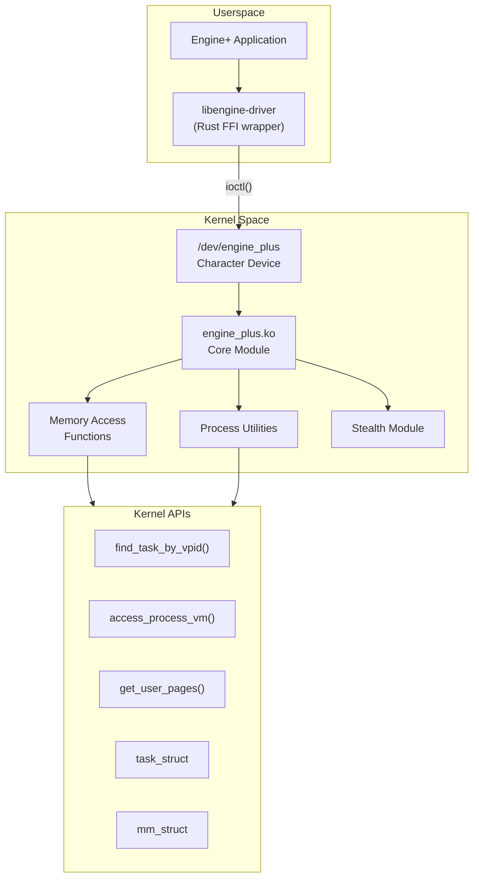
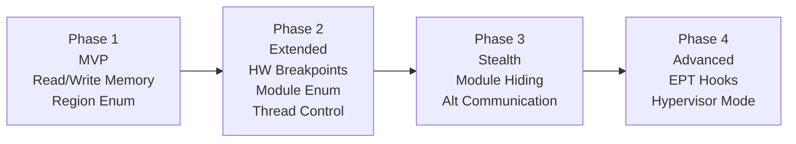

# 🔧 Driver Plan — План разработки Kernel-драйвера

## Обзор

Kernel-драйвер — это Linux Loadable Kernel Module (LKM), который обеспечивает
ring0 доступ к памяти целевых процессов без использования ptrace и /proc/pid/mem.

> [!WARNING]
> Разработка kernel-модулей требует осторожности.
> Ошибка в коде ядра = kernel panic = перезагрузка системы.
> Рекомендуется тестирование в VM (QEMU/KVM).

---

## Архитектура драйвера



---

## Фазы разработки

### Фаза 1: Базовый модуль (MVP)

**Цель:** Минимальный работающий драйвер для чтения/записи памяти.

#### Файлы

```
crates/engine-driver/
├── kernel/
│   ├── Makefile              # Kernel module build
│   ├── engine_plus.c         # Main module (C, required for LKM)
│   ├── memory.c              # Memory access functions
│   ├── ioctl_handler.c       # IOCTL processing
│   └── engine_plus.h         # Shared header
├── src/
│   ├── lib.rs                # Rust userspace library
│   ├── ioctl.rs              # IOCTL definitions (shared with C)
│   ├── client.rs             # Driver client
│   └── types.rs              # Shared types
├── Cargo.toml
└── build.rs                  # Build kernel module
```

#### IOCTL протокол (Phase 1)

```c
// Kernel-side (C)
#define ENGINE_PLUS_MAGIC 'E'

#define IOCTL_READ_MEMORY    _IOWR(ENGINE_PLUS_MAGIC, 1, struct memory_request)
#define IOCTL_WRITE_MEMORY   _IOWR(ENGINE_PLUS_MAGIC, 2, struct memory_request)
#define IOCTL_GET_REGIONS    _IOWR(ENGINE_PLUS_MAGIC, 3, struct regions_request)
#define IOCTL_GET_MODULES    _IOWR(ENGINE_PLUS_MAGIC, 4, struct modules_request)
#define IOCTL_GET_BASE       _IOWR(ENGINE_PLUS_MAGIC, 5, struct base_request)

struct memory_request {
    __u32 pid;            // Target process ID
    __u64 address;        // Virtual address in target
    __u32 size;           // Bytes to read/write
    __u64 buffer;         // Userspace buffer pointer
    __s32 result;         // Return: bytes transferred or error
};

struct regions_request {
    __u32 pid;
    __u64 buffer;         // Array of memory_region
    __u32 max_count;
    __u32 result_count;   // Return: actual count
};

struct memory_region {
    __u64 start;
    __u64 end;
    __u32 protection;     // R=1, W=2, X=4
    char  name[256];      // Module name or "[heap]", "[stack]", etc.
};
```

#### Core kernel functions

```c
// engine_plus.c — Main module
#include <linux/module.h>
#include <linux/kernel.h>
#include <linux/fs.h>
#include <linux/miscdevice.h>
#include <linux/sched.h>
#include <linux/mm.h>
#include <linux/uaccess.h>

static long eplus_ioctl(struct file *file, unsigned int cmd, unsigned long arg) {
    switch (cmd) {
        case IOCTL_READ_MEMORY:
            return handle_read_memory(arg);
        case IOCTL_WRITE_MEMORY:
            return handle_write_memory(arg);
        case IOCTL_GET_REGIONS:
            return handle_get_regions(arg);
        // ...
    }
    return -EINVAL;
}

// memory.c — Memory access
static long handle_read_memory(unsigned long arg) {
    struct memory_request req;
    struct task_struct *task;
    struct mm_struct *mm;
    int bytes_read;
    void *kbuf;
    
    if (copy_from_user(&req, (void __user *)arg, sizeof(req)))
        return -EFAULT;
    
    // Find target process
    rcu_read_lock();
    task = find_task_by_vpid(req.pid);
    if (!task) {
        rcu_read_unlock();
        return -ESRCH;
    }
    get_task_struct(task);
    rcu_read_unlock();
    
    // Get mm_struct
    mm = get_task_mm(task);
    if (!mm) {
        put_task_struct(task);
        return -EINVAL;
    }
    
    // Allocate kernel buffer
    kbuf = kmalloc(req.size, GFP_KERNEL);
    if (!kbuf) {
        mmput(mm);
        put_task_struct(task);
        return -ENOMEM;
    }
    
    // Read memory using access_process_vm
    bytes_read = access_process_vm(task, req.address, kbuf, req.size, FOLL_FORCE);
    
    // Copy to userspace
    if (bytes_read > 0) {
        if (copy_to_user((void __user *)req.buffer, kbuf, bytes_read))
            bytes_read = -EFAULT;
    }
    
    kfree(kbuf);
    mmput(mm);
    put_task_struct(task);
    
    req.result = bytes_read;
    copy_to_user((void __user *)arg, &req, sizeof(req));
    
    return bytes_read > 0 ? 0 : bytes_read;
}
```

#### Rust userspace wrapper

```rust
// src/client.rs
use std::fs::File;
use std::os::unix::io::AsRawFd;

pub struct DriverClient {
    device: File,
}

impl DriverClient {
    pub fn connect() -> Result<Self> {
        let device = File::open("/dev/engine_plus")?;
        Ok(Self { device })
    }
    
    pub fn read_memory(&self, pid: u32, address: u64, size: usize) -> Result<Vec<u8>> {
        let mut buf = vec![0u8; size];
        let mut request = MemoryRequest {
            pid,
            address,
            size: size as u32,
            buffer: buf.as_mut_ptr() as u64,
            result: 0,
        };
        
        unsafe {
            let ret = libc::ioctl(
                self.device.as_raw_fd(),
                IOCTL_READ_MEMORY,
                &mut request as *mut _ as *mut libc::c_void,
            );
            if ret < 0 {
                return Err(Error::DriverError(std::io::Error::last_os_error()));
            }
        }
        
        if request.result < 0 {
            return Err(Error::ReadFailed(request.result));
        }
        
        buf.truncate(request.result as usize);
        Ok(buf)
    }
}
```

---

### Фаза 2: Расширенные возможности

#### Hardware Breakpoints через DR-регистры

```c
// Установка hardware breakpoint из ядра
static int set_hw_breakpoint(struct task_struct *task, u64 address, int type) {
    struct perf_event_attr attr = {};
    
    attr.type = PERF_TYPE_BREAKPOINT;
    attr.bp_type = type;  // HW_BREAKPOINT_W, HW_BREAKPOINT_RW, etc.
    attr.bp_addr = address;
    attr.bp_len = HW_BREAKPOINT_LEN_4;
    attr.disabled = 0;
    
    // Register through perf_event subsystem
    // This properly manages DR0-DR3 registers
    // ...
}
```

#### Memory region enumeration из ядра

```c
static long handle_get_regions(unsigned long arg) {
    struct regions_request req;
    struct task_struct *task;
    struct mm_struct *mm;
    struct vm_area_struct *vma;
    struct vma_iterator vmi;
    int count = 0;
    
    // ... get task and mm ...
    
    mmap_read_lock(mm);
    vma_iter_init(&vmi, mm, 0);
    for_each_vma(vmi, vma) {
        struct memory_region region;
        region.start = vma->vm_start;
        region.end = vma->vm_end;
        region.protection = 0;
        if (vma->vm_flags & VM_READ)  region.protection |= 1;
        if (vma->vm_flags & VM_WRITE) region.protection |= 2;
        if (vma->vm_flags & VM_EXEC)  region.protection |= 4;
        
        // Get mapping name
        if (vma->vm_file) {
            char *path = d_path(&vma->vm_file->f_path, region.name, sizeof(region.name));
            // ...
        }
        
        // Copy to userspace
        if (copy_to_user(user_regions + count, &region, sizeof(region)))
            break;
            
        count++;
        if (count >= req.max_count) break;
    }
    mmap_read_unlock(mm);
    
    // ...
}
```

---

### Фаза 3: Stealth Features

#### Скрытие kernel module

```c
// Удаление из списка модулей
static void hide_module(void) {
    list_del_init(&THIS_MODULE->list);      // Скрыть из lsmod
    kobject_del(&THIS_MODULE->mkobj.kobj);  // Скрыть из /sys/module/
}

// Можно вернуть обратно для выгрузки
static void unhide_module(void) {
    list_add(&THIS_MODULE->list, module_previous);
    kobject_add(&THIS_MODULE->mkobj.kobj, 
                THIS_MODULE->mkobj.kobj.parent, 
                THIS_MODULE->name);
}
```

#### Скрытие device file

Вместо `/dev/engine_plus` — использовать случайное имя или procfs entry.

#### Communication через нетрадиционные каналы

Альтернативы ioctl для связи с driver-ом:

| Метод | Описание |
|-------|----------|
| **netfilter hook** | Перехват специальных сетевых пакетов (localhost) |
| **procfs entry** | /proc/engine_plus (read/write) |
| **shared memory** | mmap через chardev |
| **signaling** | Kill с особым сигналом |

---

## Тестирование

### VM-based testing

```bash
# Запуск тестовой VM через QEMU
qemu-system-x86_64 \
  -kernel bzImage \
  -initrd initramfs.img \
  -append "console=ttyS0" \
  -nographic \
  -m 2G \
  -virtfs local,path=./shared,mount_tag=host0,security_model=passthrough

# В VM:
mount -t 9p -o trans=virtio host0 /mnt
insmod /mnt/engine_plus.ko
# ... test ...
rmmod engine_plus
```

### Safety checklist

- [ ] Все `kmalloc` имеют парный `kfree`
- [ ] Все `get_task_struct` имеют парный `put_task_struct`
- [ ] Все `get_task_mm` имеют парный `mmput`
- [ ] Все `mmap_read_lock` имеют парный `mmap_read_unlock`
- [ ] `copy_from_user`/`copy_to_user` проверяются на ошибки
- [ ] RCU locks правильно используются
- [ ] Модуль корректно выгружается (cleanup)

---

## Дорожная карта Driver



| Фаза | Сроки | Приоритет |
|-------|-------|-----------|
| Phase 1: MVP | Sprint 4-5 | High |
| Phase 2: Extended | Sprint 6-7 | Medium |
| Phase 3: Stealth | Sprint 8-9 | Medium |
| Phase 4: Hypervisor | Sprint 10+ | Low (R&D) |
