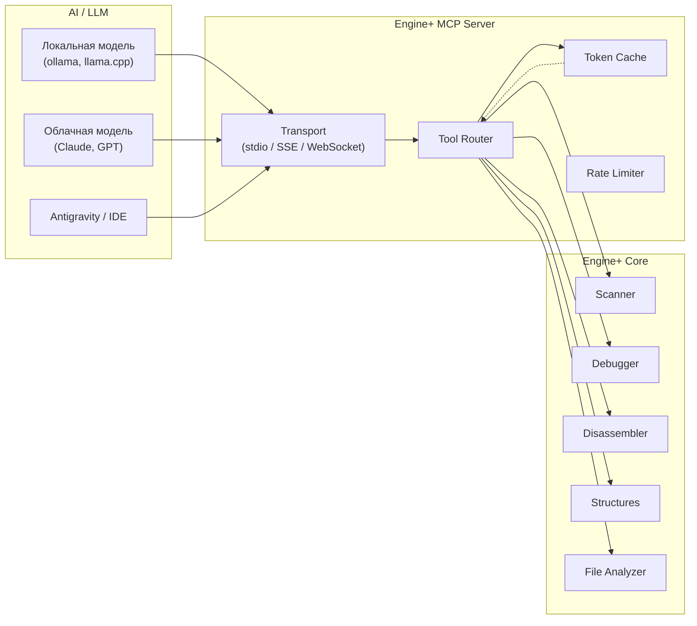

# 🤖 MCP Integration — Универсальный стандарт AI для Engine+

## Обзор

Engine+ реализует официальную спецификацию **Model Context Protocol (MCP)** в строгом соответствии с открытым стандартом.

> [!IMPORTANT]
> **Модель-независимость (Model-Agnostic):**
> MCP-сервер Engine+ **не привязан к конкретной нейросети**. Вы можете подключить к нему:
> - **Любую локальную модель:** через Ollama, llama.cpp, vLLM, LM Studio (Llama 3, Qwen 2.5, DeepSeek R1, Mistral).
> - **Любую облачную модель:** Claude 3.5/3.7, GPT-4o, Gemini 2.0 Pro и др.
> - **Любой популярный AI-агент / IDE:** Claude Desktop, Cursor, Zed, Windsurf, Continue.dev, VS Code Copilot, Antigravity.

---

## 1. Поддерживаемые стандартные транспорты

1. **`stdio` (Standard Input/Output):** Самый популярный и стабильный стандарт. Клиент (IDE или CLI-агент) запускает `engine-plus --mcp` как дочерний процесс и общается через stdin/stdout по протоколу JSON-RPC 2.0.
2. **`SSE` (Server-Sent Events) / Streamable HTTP:** Для удалённых агентов или веб-интерфейсов, когда Engine+ работает на отдельной виртуальной машине или физическом устройстве.

---

## 2. Конфигурация для популярных клиентов

### Claude Desktop (`claude_desktop_config.json`)
```json
{
  "mcpServers": {
    "engine-plus": {
      "command": "/usr/local/bin/engine-plus",
      "args": ["--mcp"]
    }
  }
}
```

### Cursor / Windsurf / Continue (`mcp.json`)
```json
{
  "mcpServers": {
    "engine-plus": {
      "command": "engine-plus",
      "args": ["--mcp"],
      "env": {
        "ENGINE_TOKEN_OPTIMIZE": "true"
      }
    }
  }
}
```

---

## 3. Архитектура взаимодействия с AI



---

## MCP Tools — Инструменты

### Категория: Process Management

#### `process_list`
Список запущенных процессов.

```json
{
  "name": "process_list",
  "description": "Получить список запущенных процессов с фильтрацией",
  "inputSchema": {
    "type": "object",
    "properties": {
      "filter": { "type": "string", "description": "Фильтр по имени процесса (regex)" },
      "include_modules": { "type": "boolean", "default": false },
      "include_threads": { "type": "boolean", "default": false }
    }
  }
}
```

#### `process_attach`
Присоединиться к процессу.

```json
{
  "name": "process_attach",
  "description": "Присоединиться к процессу для анализа",
  "inputSchema": {
    "type": "object",
    "properties": {
      "pid": { "type": "integer", "description": "Process ID" },
      "backend": {
        "type": "string",
        "enum": ["auto", "ptrace", "proc_mem", "process_vm", "driver"],
        "default": "auto"
      }
    },
    "required": ["pid"]
  }
}
```

#### `process_info`
Подробная информация о текущем процессе.

---

### Категория: Memory Operations

#### `memory_read`
Чтение памяти.

```json
{
  "name": "memory_read",
  "description": "Прочитать блок памяти из целевого процесса",
  "inputSchema": {
    "type": "object",
    "properties": {
      "address": { "type": "string", "description": "Адрес (hex или выражение: \"game.exe\"+0x1000)" },
      "size": { "type": "integer", "description": "Количество байт" },
      "format": {
        "type": "string",
        "enum": ["hex", "bytes", "ascii", "structured"],
        "default": "hex"
      },
      "interpret_as": {
        "type": "string",
        "enum": ["raw", "i8", "u8", "i16", "u16", "i32", "u32", "i64", "u64", "f32", "f64", "string_utf8", "string_utf16", "pointer_chain"],
        "description": "Интерпретировать как определённый тип"
      }
    },
    "required": ["address", "size"]
  }
}
```

#### `memory_write`
Запись в память.

#### `memory_scan`
Сканирование памяти.

```json
{
  "name": "memory_scan",
  "description": "Сканировать память процесса на заданное значение или паттерн",
  "inputSchema": {
    "type": "object",
    "properties": {
      "value": { "type": "string", "description": "Значение для поиска" },
      "value_type": {
        "type": "string",
        "enum": ["i8", "u8", "i16", "u16", "i32", "u32", "i64", "u64", "f32", "f64", "aob", "string"],
        "default": "i32"
      },
      "scan_type": {
        "type": "string",
        "enum": ["exact", "changed", "unchanged", "increased", "decreased", "between", "unknown"],
        "default": "exact"
      },
      "scan_id": { "type": "string", "description": "ID предыдущего скана для next_scan" },
      "regions": {
        "type": "string",
        "enum": ["all", "writable", "executable", "module"],
        "default": "writable"
      },
      "max_results": { "type": "integer", "default": 1000 }
    },
    "required": ["value"]
  }
}
```

#### `memory_map`
Карта памяти процесса.

---

### Категория: Analysis

#### `analyze_structure`
AI-анализ структуры данных.

```json
{
  "name": "analyze_structure",
  "description": "Автоматический анализ структуры данных по адресу. Возвращает поля с типами и уровнем уверенности.",
  "inputSchema": {
    "type": "object",
    "properties": {
      "address": { "type": "string" },
      "size": { "type": "integer", "default": 256, "description": "Предполагаемый размер структуры" },
      "depth": { "type": "integer", "default": 1, "description": "Глубина рекурсивного анализа указателей" },
      "context": { "type": "string", "description": "Контекст (например: 'game entity', 'player object')" },
      "compare_instances": {
        "type": "array",
        "items": { "type": "string" },
        "description": "Адреса других экземпляров этой же структуры для сравнения"
      }
    },
    "required": ["address"]
  }
}
```

#### `analyze_function`
Анализ функции.

```json
{
  "name": "analyze_function",
  "description": "Дизассемблировать и проанализировать функцию",
  "inputSchema": {
    "type": "object",
    "properties": {
      "address": { "type": "string" },
      "include_xrefs": { "type": "boolean", "default": true },
      "include_strings": { "type": "boolean", "default": true },
      "include_calls": { "type": "boolean", "default": true },
      "decompile": { "type": "boolean", "default": false, "description": "Попытка псевдокод-декомпиляции" }
    },
    "required": ["address"]
  }
}
```

#### `analyze_file`
Статический анализ PE/ELF файла.

```json
{
  "name": "analyze_file",
  "description": "Статический анализ исполняемого файла",
  "inputSchema": {
    "type": "object",
    "properties": {
      "path": { "type": "string", "description": "Путь к файлу" },
      "analysis_type": {
        "type": "string",
        "enum": ["overview", "imports", "exports", "strings", "sections", "entropy", "full"],
        "default": "overview"
      },
      "string_min_length": { "type": "integer", "default": 4 }
    },
    "required": ["path"]
  }
}
```

#### `find_pattern`
Поиск паттерна (AOB) в файле или памяти.

#### `pointer_scan`
Сканирование указателей.

---

### Категория: Debugger

#### `debugger_attach`
Включить режим отладки.

#### `breakpoint_set`
Установить breakpoint.

```json
{
  "name": "breakpoint_set",
  "description": "Установить точку останова",
  "inputSchema": {
    "type": "object",
    "properties": {
      "address": { "type": "string" },
      "type": {
        "type": "string",
        "enum": ["execute", "write", "read", "access"],
        "default": "execute"
      },
      "condition": { "type": "string", "description": "Условие (например: 'rax > 100')" },
      "log_expression": { "type": "string", "description": "Выражение для логирования при срабатывании" },
      "enabled": { "type": "boolean", "default": true }
    },
    "required": ["address"]
  }
}
```

#### `debugger_step`
Выполнить шаг.

#### `registers_read`
Прочитать регистры.

#### `stack_trace`
Получить стек вызовов.

---

### Категория: Scripting

#### `script_execute`
Выполнить скрипт.

```json
{
  "name": "script_execute",
  "description": "Выполнить скрипт в контексте движка",
  "inputSchema": {
    "type": "object",
    "properties": {
      "code": { "type": "string", "description": "Код скрипта" },
      "language": {
        "type": "string",
        "enum": ["lua"],
        "default": "lua"
      },
      "timeout_ms": { "type": "integer", "default": 5000 }
    },
    "required": ["code"]
  }
}
```

---

### Категория: Table Management

#### `table_add_entry`
Добавить запись в таблицу.

#### `table_freeze`
Заморозить значение.

#### `table_list`
Список записей в таблице.

#### `table_save` / `table_load`
Сохранение/загрузка таблицы.

---

## MCP Resources

MCP-ресурсы предоставляют AI контекстную информацию:

```json
[
  {
    "uri": "engine://process/current",
    "name": "Current Process Info",
    "description": "Информация о текущем присоединённом процессе"
  },
  {
    "uri": "engine://memory/map",
    "name": "Memory Map",
    "description": "Карта памяти текущего процесса"
  },
  {
    "uri": "engine://modules/list",
    "name": "Loaded Modules",
    "description": "Список загруженных модулей"
  },
  {
    "uri": "engine://scan/results/{scan_id}",
    "name": "Scan Results",
    "description": "Результаты сканирования"
  },
  {
    "uri": "engine://table/current",
    "name": "Current Cheat Table",
    "description": "Текущая активная таблица"
  },
  {
    "uri": "engine://analysis/cache",
    "name": "Analysis Cache",
    "description": "Кэшированные результаты анализа"
  }
]
```

---

## MCP Prompts

Предустановленные промпты для типичных задач:

### `reverse_structure`
```
Проанализируй блок данных по адресу {address}.
Определи типы полей, вероятное назначение, связи с другими структурами.
Используй compare_instances для повышения точности.
```

### `find_value`
```
Помоги найти значение "{description}" в игре.
Текущее значение примерно: {value}.
Предложи стратегию сканирования.
```

### `analyze_protection`
```
Проанализируй, как игра защищает значение по адресу {address}.
Найди, какие функции читают и пишут в этот адрес.
Определи, есть ли проверки валидности.
```

### `create_cheat`
```
Создай чит для "{description}".
Тип: {cheat_type} (god_mode / infinite_ammo / speed_hack / etc).
Предложи подход и создай скрипт.
```

---

## Экономия токенов

### 1. Многоуровневый кэш

```rust
pub struct TokenCache {
    /// Кэш результатов анализа (адрес → результат)
    analysis_cache: HashMap<CacheKey, CachedAnalysis>,
    
    /// Кэш дизассемблированных функций
    disasm_cache: HashMap<u64, DisasmResult>,
    
    /// Кэш структур
    struct_cache: HashMap<u64, StructureAnalysis>,
    
    /// Кэш карты памяти (обновляется по таймеру)
    memory_map_cache: Option<(Instant, Vec<MemoryRegion>)>,
    
    /// TTL для разных типов кэша
    ttl_config: TtlConfig,
}

pub struct CacheKey {
    address: u64,
    size: usize,
    context_hash: u64,  // Хэш контекста запроса
}

pub struct CachedAnalysis {
    result: AnalysisResult,
    created_at: Instant,
    access_count: u32,
    content_hash: u64,  // Хэш содержимого памяти при анализе
}
```

### 2. Компактные ответы

Вместо отправки AI сырых hex-дампов, MCP-сервер:

1. **Предварительно анализирует** данные эвристиками
2. **Группирует** повторяющиеся паттерны
3. **Отмечает** очевидные типы (строки, указатели, нули)
4. **Возвращает компактный JSON** вместо hex

```json
// Вместо: "48 65 6C 6C 6F 20 57 6F 72 6C 64 00 00 00 00 00 ..."
// AI получает:
{
  "summary": {
    "total_size": 256,
    "zero_regions": [[12, 256]],
    "strings": [{"offset": 0, "value": "Hello World", "encoding": "utf8"}],
    "pointers": [{"offset": 48, "value": "0x7F401020", "likely_vtable": true}],
    "floats": [{"offset": 16, "values": [123.45, 67.89, 10.0], "likely": "vector3d"}],
    "integers": [{"offset": 28, "value": 100, "as_i32": true}]
  },
  "hex": "48 65 6C 6C ..."  // Только если запрошен явно
}
```

### 3. Инкрементальные обновления

При повторных запросах отправляются только изменения:

```json
{
  "type": "incremental_update",
  "base_hash": "abc123",  // Ссылка на предыдущий результат
  "changes": [
    {"offset": 28, "old": "64000000", "new": "63000000", "field": "health"}
  ]
}
```

### 4. Context Budget Manager

```rust
pub struct ContextBudget {
    pub max_tokens: usize,       // Максимум токенов за сессию
    pub used_tokens: usize,      // Использовано
    pub priority: Priority,       // Приоритет: Economy / Normal / Detailed
    
    /// Автоматическое сжатие ответов при приближении к лимиту
    pub auto_compress: bool,
    
    /// Минимальный уровень детализации
    pub min_detail_level: DetailLevel,
}

pub enum DetailLevel {
    Minimal,     // Только адреса и типы
    Normal,      // + значения и имена
    Detailed,    // + hex-дампы и пояснения
    Full,        // Полная информация
}
```

### 5. Lazy Loading

AI получает структуру "по требованию":

```
Шаг 1: AI запрашивает overview структуры → получает поля без деталей
Шаг 2: AI запрашивает конкретное поле → получает полный анализ
Шаг 3: AI запрашивает вложенный указатель → рекурсивный анализ
```

Это позволяет AI сфокусироваться на интересных частях, не тратя токены на весь блок памяти.

---

## Транспорт

MCP-сервер поддерживает несколько транспортов:

| Транспорт | Описание | Для кого |
|-----------|----------|----------|
| **stdio** | Standard I/O | CLI-интеграция, локальные модели |
| **SSE** | Server-Sent Events через HTTP | Web-клиенты, IDE-интеграция |
| **WebSocket** | Двунаправленный | Real-time, remote access |

### Конфигурация MCP в IDE (пример для Antigravity/Claude)

```json
{
  "mcpServers": {
    "engine-plus": {
      "command": "engine-plus",
      "args": ["--mcp", "--transport", "stdio"],
      "env": {
        "ENGINE_PLUS_BACKEND": "auto",
        "ENGINE_PLUS_TOKEN_BUDGET": "10000"
      }
    }
  }
}
```

---

## Автоматические workflow-ы

MCP поддерживает составные workflow-ы, где AI может выполнять сложные операции:

### Пример: "Найти и защитить здоровье"

```
1. process_list(filter="game") → найти процесс
2. process_attach(pid=1234) → присоединиться
3. memory_scan(value="100", value_type="i32") → первый скан
4. [В игре: потерять здоровье]
5. memory_scan(scan_id="...", scan_type="decreased") → отсеять
6. [Повторять пока не останется 1-3 результата]
7. analyze_structure(address="...") → понять контекст
8. breakpoint_set(address="...", type="write") → найти функцию изменения
9. analyze_function(address="...") → понять логику
10. script_execute(code="...") → создать NOP-патч или hook
```

### Пример: "Реверс-инженерить структуру игрового объекта"

```
1. analyze_structure(address="...", depth=3) → начальный анализ
2. Для каждого pointer-поля:
   a. analyze_structure(address=pointer_target) → рекурсивный анализ
3. analyze_function(address=vtable[0..5]) → анализ виртуальных функций
4. Собрать полную карту объекта
5. Сгенерировать C/Rust определение структуры
```
