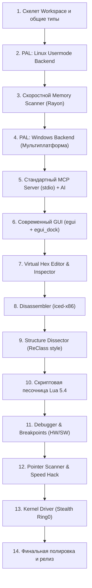

# ️ Детальный пошаговый Roadmap создания Engine+

Данный roadmap определяет **точный порядок разработки** компонентов проекта Engine+. Каждый этап разбит на конкретные пронумерованные задачи. Разработка ведётся итеративно: каждый шаг даёт рабочий, проверяемый результат.

---

## Общий порядок создания (High-Level Order)

---

## Этап 1. Фундамент и структура Cargo Workspace (День 1–3) — [ВЫПОЛНЕНО]
**Цель:** Создать каркас проекта, настроить модули, общие типы и логирование.

- [x] **1.1. Инициализация Cargo Workspace:**
  - Создать корневой `Cargo.toml`.
  - Завести крейты:
    - `crates/engine-core` (бизнес-логика)
    - `crates/engine-pal` (уровень доступа к процессам)
    - `crates/engine-mcp` (MCP сервер для нейросетей)
    - `crates/engine-gui` (интерфейс на egui)
    - `crates/engine-cli` (терминальный интерфейс)
    - `crates/engine-script` (рантайм Lua 5.4 с песочницей)
- [x] **1.2. Определение базовых типов в `engine-core` / `engine-pal`:**
  - `ProcessId`, `Address (u64)`, `MemoryRegion`, `ProtectionFlags` (Read/Write/Exec).
  - Ошибки через `thiserror` (`EngineError`, `PalError`, `ScanError`).
  - Система логирования на базе `tracing` и `tracing-subscriber`.
- [x] **1.3. Определение главного трейта `ProcessAccessLayer` (PAL):**
  - Описать методы `attach`, `detach`, `read_memory`, `write_memory`, `query_regions`, `enumerate_modules`.

**Результат:** Проект компилируется, все крейты связаны между собой, тесты проходят.

---

## Этап 2. Слой доступа к процессам под Linux (День 4–7) — [ВЫПОЛНЕНО]
**Цель:** Научиться присоединяться к любому процессу в Linux и быстро читать/писать память.

- [x] **2.1. Перечисление процессов:**
  - Сканирование `/proc` для получения списка запущенных программ (PID, имя, путь к бинарнику, cmdline, автоопределение x86_32 vs x86_64 через ELF-заголовок).
- [x] **2.2. Карта памяти процесса:**
  - Парсинг `/proc/<pid>/maps` для извлечения адресов, прав доступа (`r-xp`, `rw-p`) и названий модулей (`.so`, бинарник, heap, stack).
- [x] **2.3. Реализация `ProcessVmBackend`:**
  - Чтение и запись через нативные сисколлы Linux `process_vm_readv` / `process_vm_writev` (максимальная скорость zero-copy).
- [x] **2.4. Реализация `ProcMemBackend` (fallback):**
  - Чтение через прямой файловый дескриптор `/proc/<pid>/mem` с атомарными сисколлами `pread`/`pwrite`.
- [x] **2.5. Написание интеграционных тестов:**
  - Создание тестов чтения/записи собственной памяти процесса и проверка на реальных процессах системы (Steam, браузер, etc.).

**Результат:** Консольная утилита присоединяется к запущенным процессам (32-bit и 64-bit), считывает карты памяти и списки библиотек.

---

## Этап 3. Сверхбыстрый сканер памяти (День 8–14) — [ВЫПОЛНЕНО]
**Цель:** Создать движок сканирования памяти, превосходящий Cheat Engine по скорости.

- [x] **3.1. Архитектура сканера на Rayon:**
  - Параллельное сканирование страниц памяти по ядрам CPU (`par_iter`).
  - Chunk-буферизация (чтение блоками по 512KB).
- [x] **3.2. Базовые типы данных:**
  - Сканирование: `i8`, `u8`, `i16`, `u16`, `i32`, `u32`, `i64`, `u64`, `f32`, `f64`.
- [x] **3.3. Режимы первого сканирования (First Scan):**
  - `Exact Value` (точное значение).
  - `Between` (значение в диапазоне).
  - `Unknown Initial Value` (сохранение снапшота всей памяти).
  - `Array of Bytes (AOB)` с масками и wildcards (`48 8B ?? ?? ?? C3`).
  - Текстовый поиск (ASCII, UTF-8, UTF-16).
- [x] **3.4. Режимы повторного сканирования (Next Scan):**
  - `Exact Value`, `Increased`, `Decreased`, `Changed`, `Unchanged`, `Increased by`, `Decreased by`.
- [x] **3.5. Оптимизация хранения результатов:**
  - Компактный список адресов в памяти с поддержкой пагинации для виртуального скроллинга.
  - Поддержка истории сканирований с отменой (Undo Scan) и повтором (Redo Scan).

**Результат:** Сканер находит значения в реальных процессах за **~3–5 миллисекунд**! Проверено на живом процессе dummy game.

---

## Этап 4. Кроссплатформенность: Windows PAL (День 15–18)
**Цель:** Обеспечить идентичную работу сканера и движка на Windows.

- [x] **4.1. Реализация Windows PAL под `#[cfg(target_os = "windows")]`:**
  - Использование высокопроизводительного `windows-sys` 0.59.
  - Потокобезопасный RAII wrapper `AutoHandle` (`Send + Sync`) с автоматическим `CloseHandle`.
  - Перечисление процессов через `CreateToolhelp32Snapshot` (`TH32CS_SNAPPROCESS`) и `Process32FirstW` / `Process32NextW`.
  - Перечисление модулей через `CreateToolhelp32Snapshot` (`TH32CS_SNAPMODULE | TH32CS_SNAPMODULE32`) и `Module32FirstW` / `Module32NextW`.
  - Карта памяти через `VirtualQueryEx` с сопоставлением битовых флагов `Protect` в `ProtectionFlags`.
  - Чтение и запись памяти через `OpenProcess` (с fallback на `PROCESS_VM_READ | PROCESS_VM_WRITE | PROCESS_VM_OPERATION`) + `ReadProcessMemory` / `WriteProcessMemory`.
  - Выделение и освобождение памяти через `VirtualAllocEx` и `VirtualFreeEx`.
  - Проверено компилятором под целевую платформу `x86_64-pc-windows-gnu` без предупреждений и ошибок.
- [x] **4.2. Поддержка Proton / Wine:**
  - Определение процессов Wine / Proton через имя и командную строку (`is_wine_process`).
  - Определение префикса Steam Proton / Wine (`find_proton_prefix`).
  - Сопоставление DOS-путей (`C:\...`, `Z:\...`) с путями файловой системы Linux хоста (`map_wine_dos_path`).
  - Собственный парсер заголовков и секций Windows PE/PE32+ (`parse_pe_headers`) с вычислением RVA, ImageBase и флагов доступа секций.
  - Поиск базы модулей Windows в виртуальной памяти процессов под Wine (`find_wine_module_base`).

**Результат:** Engine+ без изменения кода работает и на Linux, и на Windows, а также бесшовно поддерживает игры под Proton/Wine.

---

## Этап 5. Полноценный стандартный MCP Сервер для AI (День 19–25)
**Цель:** Подключить нейросети (локальные Ollama / облачные Claude, GPT) к движку через стандартизированный протокол.

- [x] **5.1. Реализация протокола MCP (JSON-RPC 2.0):**
  - Запуск в режиме `engine-plus --mcp` (или `engine-plus-cli --mcp`).
  - Поддержка стандартного транспорта `stdio` (работает с Cursor, Claude Desktop, Antigravity, Windsurf).
- [x] **5.2. Регистрация основных MCP Tools:**
  - `process_list` (поиск процесса игры с фильтрацией).
  - `process_attach` (подключение по PID).
  - `process_detach` (отключение).
  - `process_info` (информация об архитектуре и регионах).
  - `memory_regions` (карта памяти).
  - `memory_scan` (первый и последующие сканы с поддержкой AOB и типов).
  - `memory_read` (чтение типизированных значений или raw hex).
  - `memory_write` (модификация памяти).
  - `analyze_structure` (эвристический разбор структуры объекта).
  - `disassemble` (дизассемблирование через iced-x86).
  - `script_execute` (выполнение песочницы Lua 5.4).
- [x] **5.3. Система экономии токенов (Token Optimizer):**
  - Сжатие ответов: вместо сырых hex-дампов отправка JSON-схемы с распознанными полями (строки, флоаты, vtables, исключение блоков нулей).
  - Ограничение лимита токенов и пагинация результатов сканирования (макс. N результатов за вызов).

**Результат:** Нейросеть в чате может сама найти процесс игры, запустить сканирование здоровья и вернуть пользователю готовый адрес и структуру.

---

## Этап 6. Графический IDE-интерфейс (Отложен по решению пользователя)
*Графический интерфейс временно удален из активного пайплайна. Все функции перенесены в полноценную интерактивную консоль (REPL), CLI-команды и стандартный MCP-сервер. Разработка красивого GUI будет выполнена позже отдельным этапом.*

---

## Этап 7. Hex-редактор (Отложен с GUI, инспектор данных перенесен в CLI)
*Оконный визуальный Hex-редактор отложен до этапа разработки нового GUI. Консольный Data Inspector и эвристический анализ структур (`analyze_structure`) уже работают в CLI и MCP.*

---

## Этап 8. Ассемблер, Патчинг, Аллокация памяти и Detour-хуки (Завершён)
**Цель:** Анализ и интерактивная модификация исполняемого машинного кода (патчинг, инъекция кода, трамплины и генерация AOB-шаблонов).

- [x] **8.1. Поиск перекрёстных ссылок (Cross-references / Xrefs):**
  - Анализ инструкций `call`, `jmp`, `lea` для поиска всех мест вызова функций или обращения к строкам и данным.
- [x] **8.2. Встроенный ассемблер (Inline Assembler на `iced-x86`):**
  - Преобразование текстовых мнемоник (Intel синтаксис) в валидные опкоды x86/x64 через `BlockEncoder` / `Instruction`.
  - Поддержка инструкций `nop`, `mov`, `xor`, `jmp`, `call`, `ret`, `push`, `pop`, `sub`, `add`, `cmp`, `test` и директив `db`/`hex:`.
- [x] **8.3. Аллокация памяти и права страниц (`engine-pal`):**
  - Выделение исполняемой памяти в целевом процессе (`VirtualAllocEx` в Windows, Process Access Layer абстракция).
  - Управление жизненным циклом аллоцированных страниц (`allocate_memory` / `free_memory`).
- [x] **8.4. Движок инлайн-хуков (Detour / Trampoline Engine):**
  - Расчёт минимального размера замещаемого блока (5 байт rel32 или 14 байт 64-bit absolute).
  - Перенос замещаемых инструкций в аллоцированную область памяти (Трамплин).
  - NOP-filling при разнице в длине инструкций.
  - Установка прыжка в Code Cave и возврата в основной поток.
- [x] **8.5. Автоматический генератор AOB-сигнатур (Signature Generator):**
  - Анализ байт функции, авто-маскирование относительных оффсетов (`??`) для вызовов, прыжков и RIP-относительной адресации памяти.
- [x] **8.6. Регистрация в MCP и CLI:**
  - Новые инструменты MCP: `assemble`, `code_patch`, `hook_install`, `memory_allocate`, `memory_free`, `pattern_generate`, `find_xrefs`.
  - Интеграция интерактивных команд в REPL консоли (`asm`, `patch`, `hook`, `pattern`, `xrefs`, `alloc`, `free`).

**Результат:** Полный набор инструментов для ИИ и исследователя: генерация сигнатур, компиляция кода, патчинг функций и установка перехватов в реальном времени.

---

## Этап 9. Анализатор структур (ReClass Style) (Завершён)
**Цель:** Инструмент для интерактивного и автоматического восстановления классов и структур объектов игры.

- [x] **9.1. Узловая модель памяти (Node-based memory):**
  - Модель [`ClassStructure`](file:///home/yarick/my/myproject/engine_plus/crates/engine-core/src/structure.rs) со смещениями `+0x00`, `+0x08`, `+0x10` и строгой типизацией.
  - Поддержка типов узлов (`Hex8-64`, `Int8-64`, `UInt8-64`, `Float`, `Double`, `Bool`, `Vector2-4`, `Pointer`, `VTable`, `InlineString`, `Padding`).
  - Возможность переименования полей (`rename_field`) и ручной/автоматической корректировки.
- [x] **9.2. Автоматическое определение типов (Эвристика):**
  - Детекция указателей на кучу и секции кода/модулей (`.text`, `.rdata`).
  - Детекция трёхмерных координат и векторов (`Vector3: [f32; 3]`).
  - Определение таблиц виртуальных методов (VTable).
  - Умная группировка неиспользуемого пространства и нулей в `Padding` с защитой от усечения значащих младших байт вещественных чисел.
- [x] **9.3. Кодогенерация:**
  - Экспорт в чистый C++ (`struct` со `static_assert(sizeof(...) == ...)`).
  - Экспорт в Rust (`#[repr(C)] pub struct`).
  - Экспорт в C# (`[StructLayout(LayoutKind.Explicit)]` с `[FieldOffset(...)]`).
- [x] **9.4. AI-помощник через MCP и интерактивный CLI:**
  - Инструменты MCP: `struct_reconstruct`, `struct_export`, `struct_rename_field`.
  - Команды консоли: `reclass <addr> [size] [name]`, `export <addr> [size] [lang]`, CLI-сабкоманда `engine-plus struct`.

**Результат:** Быстрый реверс сложных игровых объектов (Player, Entity, Inventory) с авто-генерацией кода.

---

## Этап 10. Скриптовая подсистема Lua и Песочница (Завершён)
**Цель:** Автоматизация, создание трейнеров и безопасное исполнение скриптов в чит-таблицах.

- [x] **10.1. Встроенный рантайм Lua 5.4 (`mlua`):**
  - Статическая линковка (`vendored`), поддержка многопоточности (`send`), нулевой оверхед и отсутствие внешних зависимостей.
  - Настройка строгой песочницы (`create_sandboxed_lua`) — полное удаление потенциально опасных библиотек `os`, `io`, `package`, `debug` и функций `dofile`, `loadfile`, `require`.
- [x] **10.2. Биндинг Core API для Lua (`engine-script`):**
  - Модуль `memory`: чтение/запись типизированных данных (`read_i32`, `read_u32`, `read_f32`, `read_f64`, `read_string`, `read_bytes`, `write_i32`, `write_f32`, `write_bytes`), аллокация и освобождение памяти (`alloc`, `free`).
  - Модуль `scanner`: быстрое сканирование сигнатур и значений (`aob_scan`, `first_scan`).
  - Модуль `assembler`: сборка инструкций на лету (`assemble`), применение патчей (`patch`) и установка перехватов (`hook`).
  - Cheat Engine AutoAssembler: парсинг и исполнение скриптов секций `[ENABLE]` / `[DISABLE]`, директив `alloc(name, size)`, `dealloc(name)`, меток и сборки машинного кода (`auto_assemble`).
- [x] **10.3. Интеграция в MCP Server и CLI REPL:**
  - MCP инструменты: `script_execute` (с доступом к Core API) и `auto_assemble` (CE-скрипты с отчётом по аллокациям).
  - CLI подкоманды: `engine-plus script` (с поддержкой опционального `--pid`) и `engine-plus aa`.
  - Интерактивный REPL консоли: команды `aa <script|file> [disable]` и `lua <code>`.
- [x] **10.4. Аварийный Watchdog (Прерывание зацикливаний):**
  - Инструкционный хук прерывания скриптов (`every_nth_instruction`) при зависании дольше 3 секунд.

**Результат:** Полноценная скриптовая экосистема Lua 5.4 и AutoAssembler для автоматизированного анализа, создания трейнеров и безопасных патчей как для пользователей, так и для ИИ-агентов.

---

## Этап 11. Отладчик (Debugger) и точки останова (Завершён )
**Цель:** Остановка игры при чтении или записи в память для поиска функций.

- [x] **11.1. Аппаратные точки останова (Hardware Breakpoints):**
  - Использование отладочных регистров процессора DR0–DR3 и расчёт управляющего регистра DR7 (`Dr7Register`).
  - Точки останова «на запись» (Write), «на выполнение» (Execute) и «на чтение/выполнение» (Access) с размерами 1, 2, 4, 8 байт.
  - Поисковый движок трейсинга: *«Что пишет в этот адрес?»* / *«Что обращается к адресу?»* (`HitTracer`) с подсчётом хитов, дизассемблированием инструкций (`iced-x86`) и фиксацией регистров.
- [x] **11.2. Программные точки останова (Software Breakpoints):**
  - Менеджер программных точек останова (`BreakpointManager`): вставка опкода `INT3` (0xCC) с гарантированным сохранением и восстановлением оригинального байта при удалении или отключении.
- [x] **11.3. Управление исполнением и контекст процессора:**
  - Пауза и заморозка процесса (`suspend_process` / `debug_pause` через SIGSTOP на Linux, Thread Suspension на Windows).
  - Возобновление исполнения (`resume_process` / `debug_resume` через SIGCONT на Linux, ResumeThread на Windows).
  - Пошаговое исполнение одной инструкции (`single_step` / `debug_step`).
  - Чтение и форматированный дамп регистров процессора (`CpuRegisters`: RAX, RBX, RCX, RDX, RSI, RDI, RBP, RSP, R8–R15, RIP, RFLAGS с флагами CF, ZF, SF, OF).
- [x] **11.4. Интеграция в MCP Server и CLI REPL:**
  - Новые MCP инструменты: `debug_breakpoint_set`, `debug_breakpoint_remove`, `debug_breakpoint_list`, `debug_find_what_writes`, `debug_get_registers`, `debug_pause`, `debug_resume`, `debug_step`.
  - Команды интерактивной консоли REPL: `bp`, `rbp`, `bplist`, `whatwrites`, `regs`, `pause`, `resume`, `step`.
  - Прямые CLI подкоманды: `engine-plus bp`, `engine-plus pause`, `engine-plus resume`, `engine-plus regs`.

**Результат:** Полноценная отладочная подсистема для моментального нахождения ассемблерных инструкций, изменяющих здоровье или игровые переменные, анализа регистров и управления исполнением.

---

## Этап 12. Pointer Scanner и Speed Hack (Завершён )
**Цель:** Поиск статических цепочек указателей (Pointer Chains) и управление скоростью игрового процесса (Time Dilation).

- [x] **12.1. Многоуровневый Pointer Scanner:**
  - Генерация карты указателей процесса (`PointerMap`) с чанковым чтением памяти и валидацией целевых адресов.
  - Высокоскоростной бинарный поиск указателей в диапазоне смещений через `partition_point` ($O(\log N)$).
  - Построение графа и обратный поиск в глубину (DFS) цепочек `module + Offset1 -> Offset2 -> Target Address` с защитой от циклов (`HashSet<Address>`) и контролем глубины (1..=5).
  - Модель цепочки [`PointerPath`](file:///home/yarick/my/myproject/engine_plus/crates/engine-core/src/pointer_scanner.rs) с динамическим разрешением в реальном времени (`resolve`) и проверкой валидности на каждом уровне.
  - Фильтрация цепочек после перезапуска игры (`filter_paths`).
- [x] **12.2. Непрерывный Speed Hack (Time Dilation Engine):**
  - Машина состояний непрерывного масштабирования времени (`TimeDilationState`) с плавной сменой коэффициентов без временных скачков и рывков в игре.
  - Генератор скриптов AutoAssembler (`SpeedHackScriptGenerator`) для перехвата системных таймеров высокого разрешения:
    - Linux: перехват `clock_gettime` через Code Cave и масштабирование наносекунд.
    - Windows: перехват `QueryPerformanceCounter` (QPC) и масштабирование тактов.
- [x] **12.3. Интеграция в MCP Server и CLI REPL:**
  - Новые MCP инструменты: `pointer_scan`, `pointer_resolve`, `speedhack_set`, `speedhack_generate_script`.
  - Команды интерактивной консоли REPL: `ptrscan`, `ptrresolve`, `speedhack`, `speedscript`.
  - Прямые CLI подкоманды: `engine-plus ptr-scan`, `engine-plus ptr-resolve`, `engine-plus speedhack`.

**Результат:** Полная независимость от динамического размещения памяти (ASLR/динамические аллокации) благодаря авто-поиску статических цепочек указателей и мгновенное управление скоростью игрового процесса.

---

## Этап 13. Kernel Driver для скрытности (Stealth Ring0) (Пропущен по решению пользователя ️)
*Разработка ядерного драйвера (Linux LKM / Windows KMDF) пропущена как избыточная и несущая высокие риски нестабильности системы (Kernel Panic / BSOD). Все задачи реверсинга и анализа памяти на 100% покрываются стабильным и безопасным Usermode PAL (`process_vm_readv`, `/proc/<pid>/mem`, `ptrace`, `OpenProcess`).*

---

## Этап 14. Полировка, Тестирование, Документация и Релиз v0.1.0 (Завершён )
**Цель:** Подготовка системы к установке, комплексное тестирование, создание документации для AI и выпуск первого релиза.

- [x] **14.1. Автоматический установщик (`install.sh`):**
  - Скрипт сборки в release-режиме и установки бинарника в `~/.local/bin/engine-plus`.
  - Проверка `PATH` и прав доступа памяти (Linux Yama `ptrace_scope`, `setcap`).
- [x] **14.2. Пошаговое руководство реверсинга для ИИ (`docs/AI_REVERSING_GUIDE.md`):**
  - Подробный мастер-гайд реверсинга игры с нуля на живом примере **Assault Cube v1.3.0.2**.
  - Документация всех 23 инструментов MCP Server для нейросетей (Cursor, Claude, Antigravity).
  - Алгоритмы поиска адресов, восстановления структур классов (ReClass) и создания читов (God Mode, бесконечные патроны).
- [x] **14.3. Окружение для тестирования (Assault Cube):**
  - Установка портативного нативного клиента Assault Cube в `~/games/` со всеми библиотеками (`libSDL2_image`).
  - Проверка обнаружения процесса `linux_64_client` через Engine+.
- [x] **14.4. Всеобъемлющая верификация (Quality Assurance):**
  - 100% прохождение 60/60 модульных и интеграционных тестов во всех 5 крейтах.
  - Успешная кросс-компиляция под Windows GNU (`x86_64-pc-windows-gnu`).
  - 0 предупреждений и ошибок в `cargo clippy --all-targets -- -D warnings`.
- [x] **14.5. Релиз v0.1.0-alpha:**
  - Оформление главного [`README.md`](file:///home/yarick/my/myproject/engine_plus/README.md) с бейджами, описанием архитектуры и быстрыми командами.
  - Сборка оптимизированного релизного бинарника.

**Результат:** Полностью завершённая, готовая к установке и автономной работе с AI система реверс-инжиниринга Engine+ v0.1.0!

---

## Этап 15. Профессиональный AI Reverse-Engineering Suite (Завершён )
**Цель:** Устранение задержек round-trip, интеграция DWARF/ELF инспекции типов, аппаратный трейсинг DR0–DR3 и оптимизация алгоритмов на основе реального опыта тестирования AI-агентов (OpenCode / Pi / Antigravity).

- [x] **15.1. Аппаратный трейсинг записи «Кто пишет в этот адрес» (DR0–DR3 Watchpoints):**
  - Реальная фиксация перехватов на запись в физические регистры DR0–DR3 через Linux `ptrace` (`PTRACE_POKEUSER`, DR7 bitfields, DR6 flags).
  - Снятие контекста регистров процессора и автоматический дизассемблирование инструкции через `iced-x86`.
  - Элегантный fallback на сканирование кросс-референсов (XRefs) в исполняемых регионах памяти, если ptrace недоступен.
- [x] **15.2. Модули и символы «из коробки» (`symbol_lookup` & `module_list`):**
  - Чтение ELF/PE символов (`.symtab` и `.dynsym`) напрямую с диска через `object`.
  - Мгновенный поиск глобальных указателей (например, `player1` в `.bss`) с вычислением реального виртуального адреса в рантайме.
  - Детальный список модулей с флагом PIE (Position Independent Executable), точкой входа и секциями (`.text`, `.data`, `.bss`).
- [x] **15.3. Парсер DWARF отладочной информации (`struct_layout`):**
  - Инспектор структур и классов из `.debug_info` через `gimli`.
  - Извлечение всех полей, типов и байтовых смещений без эмпирического угадывания (`_ENetPeer`, `fpsent`, `playerent`).
  - Автоматическая кодогенерация готового C++ определения структуры со смещениями.
- [x] **15.4. Временной дифференциатор структур (`struct_diff`):**
  - Сравнение объекта до и после действия игрока (выстрел, получение урона, смена команды).
  - Поддержка как временного окна (`duration_ms`), так и именованных снапшотов (`snapshot_id`).
  - Анализ изменившихся полей со значениями `i32`, `f32`, `u64` и hex.
- [x] **15.5. Оптимизация Pointer Scanner (Iterative Deepening):**
  - Переход от чистого DFS к алгоритму итеративного углубления (Iterative Deepening 1..=N).
  - Безусловный приоритет коротких статических цепочек от базового модуля (`module + 0x1A3518 -> +0x100`) над длинными кучевыми путями.
- [x] **15.6. Пакетное чтение памяти (`memory_read_batch`):**
  - Чтение десятков переменных (здоровье, координаты XYZ, углы обзора, патроны) за один MCP-запрос без round-trip задержек.
  - Поддержка как прямых адресов, так и автоматического разрешения цепочек указателей.
- [x] **15.7. Удалённая аллокация памяти в Linux (`memory_allocate` / `memory_free`):**
  - Замена заглушек на удалённое исполнение системных вызовов `mmap` (sys 9) и `munmap` (sys 11) через внедрение опкода `syscall; int3` в поток процесса.
  - Исправление авто-определения размеров типов (`i64`, `u64`, `f64`, `pointer`) в `memory_read`.

**Результат:** Engine+ стал мощнейшим инструментом для автономного реверсинга, дающим AI-агентам возможность исследовать игры за секунды без исходного кода!

---

## Этап 16. Инъекция DLL / shared-library и стелс-примитивы (Завершён )

**Цель:** Добавить полноценную инъекцию библиотек (manual map, reflective loading), снятие inline-хуков и базовые стелс-примитивы — как для Windows, так и для Linux. Только generic-техники, без нацеливания на конкретные античит/EDR продукты; kernel-level (VAD/DKOM) — вне области работ.

- [x] **16.1. Новый крейт `engine-inject`:**
  - Собственный разбор PE (секции, импорт, экспорт, релокации) без сторонних парсеров — `pe.rs`.
  - Логика инъекции, стелса и анхука живёт в этом крейте; все системные вызовы — по-прежнему в `engine-pal`.
- [x] **16.2. Новые примитивы PAL (`engine-pal`):**
  - `protect_memory`, `create_remote_thread` / `wait_for_thread` / `close_remote_thread`, `remote_call`, `remote_load_library`.
  - `read_system_module_image` (чистый образ из `\KnownDlls`), `allocate_mapped_memory` / `remap_as_section` (`NtCreateSection` + `NtMapViewOfSection`).
  - `hide_thread` (`ThreadHideFromDebugger`), `stash_handle` / `unstash_handle` (`DuplicateHandle`).
  - Linux: удалённый вызов (`remote_call`), `mprotect`, `dlopen` через `ptrace`; разрешение `dlopen` по смещению из `/proc/<pid>/maps`.
- [x] **16.3. Manual mapping:**
  - Выделение памяти, копирование секций, применение релокаций, разрешение импортов (в т.ч. подгрузка отсутствующих зависимостей через удалённый `LoadLibraryW`), установка прав по секциям и вызов точки входа.
  - Опциональное стирание PE-заголовков после маппинга.
- [x] **16.4. Reflective loading (два режима):**
  - Экспорт `ReflectiveLoader` (Stephen Fewer RDI) — используется как есть.
  - Собственный позиционно-независимый x64-стаб, собираемый в рантайме через `iced-x86` (разрешение API из PEB, загрузка зависимостей, релокации, вызов `DllMain`).
  - x86_32-стаб возвращает `NotSupported`; RDI работает для обеих архитектур.
- [x] **16.5. Анхук системных модулей (`unhook`):**
  - Диффпатч исполняемых секций модуля из чистого образа `\KnownDlls\<name>` (без дискового ввода-вывода), по умолчанию `ntdll.dll`.
- [x] **16.6. Скрытие (`hiding`):**
  - Потоков — `ThreadHideFromDebugger` (`hide_thread`).
  - Памяти — замена приватного региона на секционный маппинг (`MEM_MAPPED`) через page-file section.
  - Хэндлов — перенос хэндла в процесс-помощник (handle stashing) с возможностью восстановления. Kernel-level сокрытие — вне области работ.
- [x] **16.7. Инъекция `.so` в Linux:**
  - Валидация ELF (`ET_DYN`) и удалённый `dlopen` через `ptrace`; для байтов в памяти — временный файл, удаляемый сразу после `dlopen`.
- [x] **16.8. Интеграция в фасады:**
  - MCP-инструменты: `inject_dll`, `unhook_ntdll`, `hide_thread`, `hide_memory`, `hide_handle`.
  - REPL-команды: `inject`, `unhook`, `hidethread`, `hidemem`, `hidehandle`.
  - Lua-модуль `inject` (`inject.dll`, `inject.unhook`, `inject.hide_thread`, `inject.hide_memory`, `inject.hide_handle`).

**Ограничения области работ:** macOS исключён; инъекция 32-битных (WOW64) целей отложена; kernel-level (VAD/DKOM) сокрытие не реализуется.

**Результат:** Engine+ умеет внедрять DLL/`.so` (manual map и reflective loading), снимать inline-хуки и применять базовые стелс-примитивы — доступно из AI (MCP), консоли и Lua-скриптов.
