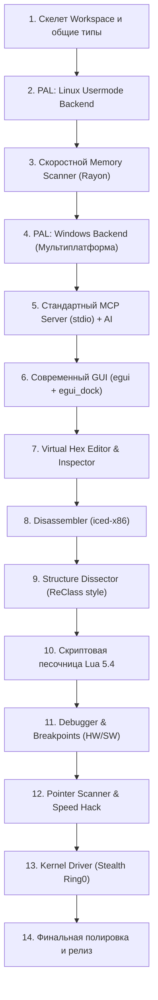

# 🗺️ Детальный пошаговый Roadmap создания Engine+

Данный roadmap определяет **точный порядок разработки** компонентов проекта Engine+. Каждый этап разбит на конкретные пронумерованные задачи. Разработка ведётся итеративно: каждый шаг даёт рабочий, проверяемый результат.

---

## 📌 Общий порядок создания (High-Level Order)

---

## Этап 1. Фундамент и структура Cargo Workspace (День 1–3) — [ВЫПОЛНЕНО ✅]
**Цель:** Создать каркас проекта, настроить модули, общие типы и логирование.

- [x] **1.1. Инициализация Cargo Workspace:**
  - Создать корневой `Cargo.toml`.
  - Завести крейты:
    - `crates/engine-core` (бизнес-логика)
    - `crates/engine-pal` (уровень доступа к процессам)
    - `crates/engine-mcp` (MCP сервер для нейросетей)
    - `crates/engine-gui` (интерфейс на egui)
    - `crates/engine-cli` (терминальный интерфейс)
    - `crates/engine-script` (рантайм Lua 5.4 с песочницей)
- [x] **1.2. Определение базовых типов в `engine-core` / `engine-pal`:**
  - `ProcessId`, `Address (u64)`, `MemoryRegion`, `ProtectionFlags` (Read/Write/Exec).
  - Ошибки через `thiserror` (`EngineError`, `PalError`, `ScanError`).
  - Система логирования на базе `tracing` и `tracing-subscriber`.
- [x] **1.3. Определение главного трейта `ProcessAccessLayer` (PAL):**
  - Описать методы `attach`, `detach`, `read_memory`, `write_memory`, `query_regions`, `enumerate_modules`.

**Результат:** Проект компилируется, все крейты связаны между собой, тесты проходят.

---

## Этап 2. Слой доступа к процессам под Linux (День 4–7) — [ВЫПОЛНЕНО ✅]
**Цель:** Научиться присоединяться к любому процессу в Linux и быстро читать/писать память.

- [x] **2.1. Перечисление процессов:**
  - Сканирование `/proc` для получения списка запущенных программ (PID, имя, путь к бинарнику, cmdline, автоопределение x86_32 vs x86_64 через ELF-заголовок).
- [x] **2.2. Карта памяти процесса:**
  - Парсинг `/proc/<pid>/maps` для извлечения адресов, прав доступа (`r-xp`, `rw-p`) и названий модулей (`.so`, бинарник, heap, stack).
- [x] **2.3. Реализация `ProcessVmBackend`:**
  - Чтение и запись через нативные сисколлы Linux `process_vm_readv` / `process_vm_writev` (максимальная скорость zero-copy).
- [x] **2.4. Реализация `ProcMemBackend` (fallback):**
  - Чтение через прямой файловый дескриптор `/proc/<pid>/mem` с атомарными сисколлами `pread`/`pwrite`.
- [x] **2.5. Написание интеграционных тестов:**
  - Создание тестов чтения/записи собственной памяти процесса и проверка на реальных процессах системы (Steam, браузер, etc.).

**Результат:** Консольная утилита присоединяется к запущенным процессам (32-bit и 64-bit), считывает карты памяти и списки библиотек.

---

## Этап 3. Сверхбыстрый сканер памяти (День 8–14) — [ВЫПОЛНЕНО ✅]
**Цель:** Создать движок сканирования памяти, превосходящий Cheat Engine по скорости.

- [x] **3.1. Архитектура сканера на Rayon:**
  - Параллельное сканирование страниц памяти по ядрам CPU (`par_iter`).
  - Chunk-буферизация (чтение блоками по 512KB).
- [x] **3.2. Базовые типы данных:**
  - Сканирование: `i8`, `u8`, `i16`, `u16`, `i32`, `u32`, `i64`, `u64`, `f32`, `f64`.
- [x] **3.3. Режимы первого сканирования (First Scan):**
  - `Exact Value` (точное значение).
  - `Between` (значение в диапазоне).
  - `Unknown Initial Value` (сохранение снапшота всей памяти).
  - `Array of Bytes (AOB)` с масками и wildcards (`48 8B ?? ?? ?? C3`).
  - Текстовый поиск (ASCII, UTF-8, UTF-16).
- [x] **3.4. Режимы повторного сканирования (Next Scan):**
  - `Exact Value`, `Increased`, `Decreased`, `Changed`, `Unchanged`, `Increased by`, `Decreased by`.
- [x] **3.5. Оптимизация хранения результатов:**
  - Компактный список адресов в памяти с поддержкой пагинации для виртуального скроллинга.
  - Поддержка истории сканирований с отменой (Undo Scan) и повтором (Redo Scan).

**Результат:** Сканер находит значения в реальных процессах за **~3–5 миллисекунд**! Проверено на живом процессе dummy game.

---

## Этап 4. Кроссплатформенность: Windows PAL (День 15–18)
**Цель:** Обеспечить идентичную работу сканера и движка на Windows.

- [x] **4.1. Реализация Windows PAL под `#[cfg(target_os = "windows")]`:**
  - Использование высокопроизводительного `windows-sys` 0.59.
  - Потокобезопасный RAII wrapper `AutoHandle` (`Send + Sync`) с автоматическим `CloseHandle`.
  - Перечисление процессов через `CreateToolhelp32Snapshot` (`TH32CS_SNAPPROCESS`) и `Process32FirstW` / `Process32NextW`.
  - Перечисление модулей через `CreateToolhelp32Snapshot` (`TH32CS_SNAPMODULE | TH32CS_SNAPMODULE32`) и `Module32FirstW` / `Module32NextW`.
  - Карта памяти через `VirtualQueryEx` с сопоставлением битовых флагов `Protect` в `ProtectionFlags`.
  - Чтение и запись памяти через `OpenProcess` (с fallback на `PROCESS_VM_READ | PROCESS_VM_WRITE | PROCESS_VM_OPERATION`) + `ReadProcessMemory` / `WriteProcessMemory`.
  - Выделение и освобождение памяти через `VirtualAllocEx` и `VirtualFreeEx`.
  - Проверено компилятором под целевую платформу `x86_64-pc-windows-gnu` без предупреждений и ошибок.
- [x] **4.2. Поддержка Proton / Wine:**
  - Определение процессов Wine / Proton через имя и командную строку (`is_wine_process`).
  - Определение префикса Steam Proton / Wine (`find_proton_prefix`).
  - Сопоставление DOS-путей (`C:\...`, `Z:\...`) с путями файловой системы Linux хоста (`map_wine_dos_path`).
  - Собственный парсер заголовков и секций Windows PE/PE32+ (`parse_pe_headers`) с вычислением RVA, ImageBase и флагов доступа секций.
  - Поиск базы модулей Windows в виртуальной памяти процессов под Wine (`find_wine_module_base`).

**Результат:** Engine+ без изменения кода работает и на Linux, и на Windows, а также бесшовно поддерживает игры под Proton/Wine.

---

## Этап 5. Полноценный стандартный MCP Сервер для AI (День 19–25)
**Цель:** Подключить нейросети (локальные Ollama / облачные Claude, GPT) к движку через стандартизированный протокол.

- [x] **5.1. Реализация протокола MCP (JSON-RPC 2.0):**
  - Запуск в режиме `engine-plus --mcp` (или `engine-plus-cli --mcp`).
  - Поддержка стандартного транспорта `stdio` (работает с Cursor, Claude Desktop, Antigravity, Windsurf).
- [x] **5.2. Регистрация основных MCP Tools:**
  - `process_list` (поиск процесса игры с фильтрацией).
  - `process_attach` (подключение по PID).
  - `process_detach` (отключение).
  - `process_info` (информация об архитектуре и регионах).
  - `memory_regions` (карта памяти).
  - `memory_scan` (первый и последующие сканы с поддержкой AOB и типов).
  - `memory_read` (чтение типизированных значений или raw hex).
  - `memory_write` (модификация памяти).
  - `analyze_structure` (эвристический разбор структуры объекта).
  - `disassemble` (дизассемблирование через iced-x86).
  - `script_execute` (выполнение песочницы Lua 5.4).
- [x] **5.3. Система экономии токенов (Token Optimizer):**
  - Сжатие ответов: вместо сырых hex-дампов отправка JSON-схемы с распознанными полями (строки, флоаты, vtables, исключение блоков нулей).
  - Ограничение лимита токенов и пагинация результатов сканирования (макс. N результатов за вызов).

**Результат:** Нейросеть в чате может сама найти процесс игры, запустить сканирование здоровья и вернуть пользователю готовый адрес и структуру.

---

## Этап 6. Графический IDE-интерфейс (Отложен по решению пользователя)
*Графический интерфейс временно удален из активного пайплайна. Все функции перенесены в полноценную интерактивную консоль (REPL), CLI-команды и стандартный MCP-сервер. Разработка красивого GUI будет выполнена позже отдельным этапом.*

---

## Этап 7. Hex-редактор (Отложен с GUI, инспектор данных перенесен в CLI)
*Оконный визуальный Hex-редактор отложен до этапа разработки нового GUI. Консольный Data Inspector и эвристический анализ структур (`analyze_structure`) уже работают в CLI и MCP.*

---

## Этап 8. Ассемблер, Патчинг, Аллокация памяти и Detour-хуки (Завершён)
**Цель:** Анализ и интерактивная модификация исполняемого машинного кода (патчинг, инъекция кода, трамплины и генерация AOB-шаблонов).

- [x] **8.1. Поиск перекрёстных ссылок (Cross-references / Xrefs):**
  - Анализ инструкций `call`, `jmp`, `lea` для поиска всех мест вызова функций или обращения к строкам и данным.
- [x] **8.2. Встроенный ассемблер (Inline Assembler на `iced-x86`):**
  - Преобразование текстовых мнемоник (Intel синтаксис) в валидные опкоды x86/x64 через `BlockEncoder` / `Instruction`.
  - Поддержка инструкций `nop`, `mov`, `xor`, `jmp`, `call`, `ret`, `push`, `pop`, `sub`, `add`, `cmp`, `test` и директив `db`/`hex:`.
- [x] **8.3. Аллокация памяти и права страниц (`engine-pal`):**
  - Выделение исполняемой памяти в целевом процессе (`VirtualAllocEx` в Windows, Process Access Layer абстракция).
  - Управление жизненным циклом аллоцированных страниц (`allocate_memory` / `free_memory`).
- [x] **8.4. Движок инлайн-хуков (Detour / Trampoline Engine):**
  - Расчёт минимального размера замещаемого блока (5 байт rel32 или 14 байт 64-bit absolute).
  - Перенос замещаемых инструкций в аллоцированную область памяти (Трамплин).
  - NOP-filling при разнице в длине инструкций.
  - Установка прыжка в Code Cave и возврата в основной поток.
- [x] **8.5. Автоматический генератор AOB-сигнатур (Signature Generator):**
  - Анализ байт функции, авто-маскирование относительных оффсетов (`??`) для вызовов, прыжков и RIP-относительной адресации памяти.
- [x] **8.6. Регистрация в MCP и CLI:**
  - Новые инструменты MCP: `assemble`, `code_patch`, `hook_install`, `memory_allocate`, `memory_free`, `pattern_generate`, `find_xrefs`.
  - Интеграция интерактивных команд в REPL консоли (`asm`, `patch`, `hook`, `pattern`, `xrefs`, `alloc`, `free`).

**Результат:** Полный набор инструментов для ИИ и исследователя: генерация сигнатур, компиляция кода, патчинг функций и установка перехватов в реальном времени.

---

## Этап 9. Анализатор структур (ReClass Style) (Завершён)
**Цель:** Инструмент для интерактивного и автоматического восстановления классов и структур объектов игры.

- [x] **9.1. Узловая модель памяти (Node-based memory):**
  - Модель [`ClassStructure`](file:///home/yarick/my/myproject/engine_plus/crates/engine-core/src/structure.rs) со смещениями `+0x00`, `+0x08`, `+0x10` и строгой типизацией.
  - Поддержка типов узлов (`Hex8-64`, `Int8-64`, `UInt8-64`, `Float`, `Double`, `Bool`, `Vector2-4`, `Pointer`, `VTable`, `InlineString`, `Padding`).
  - Возможность переименования полей (`rename_field`) и ручной/автоматической корректировки.
- [x] **9.2. Автоматическое определение типов (Эвристика):**
  - Детекция указателей на кучу и секции кода/модулей (`.text`, `.rdata`).
  - Детекция трёхмерных координат и векторов (`Vector3: [f32; 3]`).
  - Определение таблиц виртуальных методов (VTable).
  - Умная группировка неиспользуемого пространства и нулей в `Padding` с защитой от усечения значащих младших байт вещественных чисел.
- [x] **9.3. Кодогенерация:**
  - Экспорт в чистый C++ (`struct` со `static_assert(sizeof(...) == ...)`).
  - Экспорт в Rust (`#[repr(C)] pub struct`).
  - Экспорт в C# (`[StructLayout(LayoutKind.Explicit)]` с `[FieldOffset(...)]`).
- [x] **9.4. AI-помощник через MCP и интерактивный CLI:**
  - Инструменты MCP: `struct_reconstruct`, `struct_export`, `struct_rename_field`.
  - Команды консоли: `reclass <addr> [size] [name]`, `export <addr> [size] [lang]`, CLI-сабкоманда `engine-plus struct`.

**Результат:** Быстрый реверс сложных игровых объектов (Player, Entity, Inventory) с авто-генерацией кода.

---

## Этап 10. Скриптовая подсистема Lua и Песочница (Завершён)
**Цель:** Автоматизация, создание трейнеров и безопасное исполнение скриптов в чит-таблицах.

- [x] **10.1. Встроенный рантайм Lua 5.4 (`mlua`):**
  - Статическая линковка (`vendored`), поддержка многопоточности (`send`), нулевой оверхед и отсутствие внешних зависимостей.
  - Настройка строгой песочницы (`create_sandboxed_lua`) — полное удаление потенциально опасных библиотек `os`, `io`, `package`, `debug` и функций `dofile`, `loadfile`, `require`.
- [x] **10.2. Биндинг Core API для Lua (`engine-script`):**
  - Модуль `memory`: чтение/запись типизированных данных (`read_i32`, `read_u32`, `read_f32`, `read_f64`, `read_string`, `read_bytes`, `write_i32`, `write_f32`, `write_bytes`), аллокация и освобождение памяти (`alloc`, `free`).
  - Модуль `scanner`: быстрое сканирование сигнатур и значений (`aob_scan`, `first_scan`).
  - Модуль `assembler`: сборка инструкций на лету (`assemble`), применение патчей (`patch`) и установка перехватов (`hook`).
  - Cheat Engine AutoAssembler: парсинг и исполнение скриптов секций `[ENABLE]` / `[DISABLE]`, директив `alloc(name, size)`, `dealloc(name)`, меток и сборки машинного кода (`auto_assemble`).
- [x] **10.3. Интеграция в MCP Server и CLI REPL:**
  - MCP инструменты: `script_execute` (с доступом к Core API) и `auto_assemble` (CE-скрипты с отчётом по аллокациям).
  - CLI подкоманды: `engine-plus script` (с поддержкой опционального `--pid`) и `engine-plus aa`.
  - Интерактивный REPL консоли: команды `aa <script|file> [disable]` и `lua <code>`.
- [x] **10.4. Аварийный Watchdog (Прерывание зацикливаний):**
  - Инструкционный хук прерывания скриптов (`every_nth_instruction`) при зависании дольше 3 секунд.

**Результат:** Полноценная скриптовая экосистема Lua 5.4 и AutoAssembler для автоматизированного анализа, создания трейнеров и безопасных патчей как для пользователей, так и для ИИ-агентов.

---

## Этап 11. Отладчик (Debugger) и точки останова (День 69–78)
**Цель:** Остановка игры при чтении или записи в память для поиска функций.

- [ ] **11.1. Аппаратные точки останова (Hardware Breakpoints):**
  - Использование отладочных регистров процессора DR0–DR3.
  - Точки останова «на запись» (Write) и «на чтение/выполнение» (Access).
  - Поиск инструкции: *«Что пишет в этот адрес?»* (самая популярная фича Cheat Engine).
- [ ] **11.2. Программные точки останова (Software Breakpoints):**
  - Вставка опкода `INT3` (0xCC) с восстановлением оригинального байта.
- [ ] **11.3. Управление исполнением:**
  - Пауза, продолжение (`F5`), шаг с заходом (`Step Into`, F7), шаг через (`Step Over`, F8).
  - Окно просмотра значений регистров процессора (`rax`, `rbx`, `rsp`, флаги `EFLAGS`).

**Результат:** Возможность за секунды находить ассемблерный код, уменьшающий патроны или здоровье игрока.

---

## Этап 12. Pointer Scanner и Speed Hack (День 79–86)
**Цель:** Поиск статических указателей и управление скоростью игры.

- [ ] **12.1. Многоуровневый Pointer Scanner:**
  - Построение графа указателей в памяти процесса.
  - Поиск цепочек `game.exe + Offset1 -> Offset2 -> Target Address`.
  - Сохранение карты указателей и повторное сканирование после перезапуска игры.
- [ ] **12.2. Speed Hack:**
  - Перехват функций времени (`clock_gettime` на Linux, `QueryPerformanceCounter` / `GetTickCount` на Windows).
  - Ползунок в GUI для замедления (0.1x) или ускорения (10x) игрового процесса.

**Результат:** Создание стабильных читов, не слетающих при перезапуске игры.

---

## Этап 13. Kernel Driver для скрытности (Stealth Ring0) (День 87–100+)
**Цель:** Невидимый доступ к памяти для обхода антивирусов и систем защиты.

- [ ] **13.1. Создание Linux LKM драйвера (`engine_plus.ko`):**
  - Символьное устройство `/dev/engine_plus`.
  - IOCTL-команды чтения/записи через функции ядра `access_process_vm()`.
  - Отсутствие отладочного статуса (`TracerPid == 0` в `/proc/pid/status`).
- [ ] **13.2. Rust Client в `engine-pal`:**
  - Драйверный бэкенд, реализующий `ProcessAccessLayer` через системные ioctl.
- [ ] **13.3. Windows Kernel Driver (следующий шаг):**
  - Разработка KMDF-драйвера для прямого доступа к структурам `EPROCESS`.

**Результат:** Полная скрытность от юзермодных сканеров и антивирусов.

---

## Этап 14. Полировка, Тестирование и Документация
- [ ] **14.1.** Проведение фаззинг-тестов парсеров файлов (PE / ELF) и командной строки.
- [ ] **14.2.** Оптимизация горячих циклов с помощью профилировщиков (Flamegraph, perf).
- [ ] **14.3.** Финализация пользовательской документации и видео/GIF-демонстраций.
- [ ] **14.4.** Релиз первой открытой версии v0.1.0-alpha.
