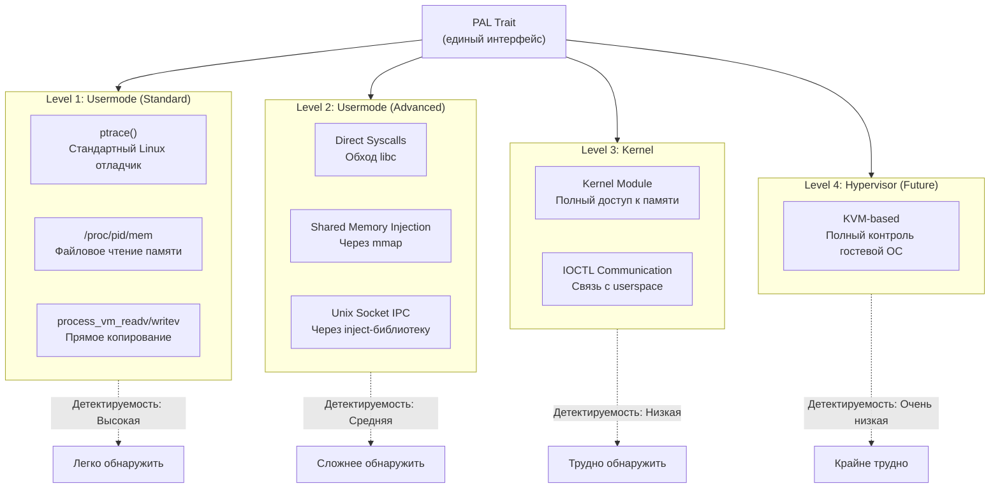

# 🛡️ Stealth System — Низкоуровневое взаимодействие

## Обзор

Engine+ использует абстракцию **PAL (Process Access Layer)** для взаимодействия
с целевыми процессами. Это позволяет менять backend без изменения логики движка.

> [!CAUTION]
> Данная документация описывает технические возможности для исследовательских целей.
> Использование для обхода защиты коммерческого ПО может нарушать EULA и законодательство.

---

## Многоуровневая модель backend-ов



---

## Level 1: Standard Usermode Backends

### 1.1 ptrace Backend

Стандартный механизм отладки Linux.

```rust
pub struct PtraceBackend {
    pid: u32,
    attached: bool,
    breakpoints: HashMap<u64, u8>,  // addr -> original byte
}

impl ProcessAccessLayer for PtraceBackend {
    fn read_memory(&self, address: u64, size: usize) -> Result<Vec<u8>> {
        // PTRACE_PEEKDATA — по 8 байт за раз
        // Медленно для больших регионов, но универсально
        let mut data = Vec::with_capacity(size);
        for offset in (0..size).step_by(8) {
            let word = ptrace::read(self.pid, (address + offset as u64) as *mut _)?;
            data.extend_from_slice(&word.to_ne_bytes()[..min(8, size - offset)]);
        }
        Ok(data)
    }
    
    fn set_breakpoint(&mut self, address: u64, _: BreakpointType) -> Result<BreakpointId> {
        // Сохраняем оригинальный байт, пишем INT3 (0xCC)
        let original = self.read_memory(address, 1)?[0];
        self.breakpoints.insert(address, original);
        self.write_memory(address, &[0xCC])?;
        Ok(BreakpointId(address))
    }
    
    fn stealth_level(&self) -> StealthLevel {
        StealthLevel::None  // Легко обнаружить через /proc/pid/status
    }
}
```

**Характеристики:**
- ✅ Полная отладка (breakpoints, stepping, registers)
- ✅ Универсальность (любой процесс, any arch)
- ❌ Медленное чтение (8 байт за syscall)
- ❌ Легко обнаруживается (TracerPid в /proc/self/status)

### 1.2 /proc/pid/mem Backend

Файловое чтение памяти процесса.

```rust
pub struct ProcMemBackend {
    pid: u32,
    mem_file: File,  // /proc/pid/mem
    maps: Vec<MemoryRegion>,
}

impl ProcessAccessLayer for ProcMemBackend {
    fn read_memory(&self, address: u64, size: usize) -> Result<Vec<u8>> {
        let mut buf = vec![0u8; size];
        self.mem_file.seek(SeekFrom::Start(address))?;
        self.mem_file.read_exact(&mut buf)?;
        Ok(buf)
    }
    
    fn write_memory(&self, address: u64, data: &[u8]) -> Result<()> {
        self.mem_file.seek(SeekFrom::Start(address))?;
        self.mem_file.write_all(data)?;
        Ok(())
    }
    
    fn stealth_level(&self) -> StealthLevel {
        StealthLevel::Low  // Файловый дескриптор виден, но нет ptrace
    }
}
```

**Характеристики:**
- ✅ Быстрое чтение/запись (один syscall для любого размера)
- ✅ Не требует ptrace_attach
- ❌ Нет отладочных возможностей (нет breakpoints)
- ❌ Дескриптор `/proc/pid/mem` виден

### 1.3 process_vm_readv/writev Backend

Прямое копирование памяти между процессами.

```rust
pub struct ProcessVmBackend {
    pid: u32,
}

impl ProcessAccessLayer for ProcessVmBackend {
    fn read_memory(&self, address: u64, size: usize) -> Result<Vec<u8>> {
        let mut buf = vec![0u8; size];
        let local_iov = IoVec::from_mut_slice(&mut buf);
        let remote_iov = RemoteIoVec { base: address as usize, len: size };
        
        process_vm_readv(self.pid, &[local_iov], &[remote_iov])?;
        Ok(buf)
    }
    
    fn stealth_level(&self) -> StealthLevel {
        StealthLevel::Low  // Менее заметно, но всё ещё syscall
    }
}
```

**Характеристики:**
- ✅ Максимально быстрое для usermode (zero-copy в ядре)
- ✅ Scatter-gather I/O (несколько регионов за один syscall)
- ❌ Нет отладки
- ❌ Обнаруживается через auditd/seccomp

---

## Level 2: Advanced Usermode Backends

### 2.1 Direct Syscalls

Обход libc для затруднения hook-based детекции:

```rust
pub struct DirectSyscallBackend {
    pid: u32,
}

impl DirectSyscallBackend {
    /// Прямой syscall, минуя libc
    unsafe fn raw_process_vm_readv(
        pid: i32,
        local_iov: *const iovec,
        liovcnt: u64,
        remote_iov: *const iovec,
        riovcnt: u64,
        flags: u64,
    ) -> i64 {
        let result: i64;
        // x86_64: syscall number 310 = process_vm_readv
        core::arch::asm!(
            "syscall",
            inout("rax") 310u64 => result,
            in("rdi") pid as u64,
            in("rsi") local_iov as u64,
            in("rdx") liovcnt,
            in("r10") remote_iov as u64,
            in("r8") riovcnt,
            in("r9") flags,
            lateout("rcx") _,
            lateout("r11") _,
        );
        result
    }
}
```

**Характеристики:**
- ✅ Обходит libc hooks
- ✅ Не видна в LD_PRELOAD-трассировке
- ❌ x86_64-specific
- ❌ Обнаруживается через seccomp BPF

### 2.2 Shared Memory Injection

Инжект маленькой библиотеки в целевой процесс, которая создаёт
shared memory для обмена данными:

```
Engine+ Process                    Target Process
┌──────────────┐                  ┌──────────────┐
│              │   shared memory  │  injected    │
│  PAL Client  │◄═══════════════►│  helper.so   │
│              │   /dev/shm/...  │              │
└──────────────┘                  └──────────────┘
```

**Протокол обмена:**
```rust
#[repr(C)]
pub struct SharedCommand {
    pub command_type: u32,    // READ = 1, WRITE = 2, QUERY = 3
    pub address: u64,
    pub size: u32,
    pub status: AtomicU32,    // PENDING = 0, DONE = 1, ERROR = 2
    pub data: [u8; 4096],     // Буфер данных
}
```

**Характеристики:**
- ✅ Обмен без syscall-ов после setup
- ✅ Высокая скорость (memory-mapped)
- ❌ Требует инжекции (одноразовый ptrace или dlopen)
- ❌ Библиотека видна в /proc/pid/maps

### 2.3 Unix Socket IPC

Подобно shared memory, но через Unix domain socket:

**Характеристики:**
- ✅ Стандартный IPC механизм
- ✅ Более гибкий протокол
- ❌ Медленнее shared memory
- ❌ Сокет виден

---

## Level 3: Kernel Backend

### 3.1 Kernel Module (LKM)

Загружаемый модуль ядра для прямого доступа к памяти любого процесса.

```
Engine+ Process                    Kernel Space
┌──────────────┐    ioctl()      ┌──────────────────────┐
│              │ ◄═══════════►  │  engine_plus.ko       │
│  PAL Client  │   /dev/eplus   │                        │
│              │                 │  copy_from_user()      │
└──────────────┘                 │  find_task_by_vpid()   │
                                 │  access_process_vm()   │
                                 │  ...                   │
                                 └──────────────────────┘
                                          │
                                          ▼
                                 ┌──────────────────────┐
                                 │  Target Process       │
                                 │  (любой, ring0 access)│
                                 └──────────────────────┘
```

### IOCTL Interface

```rust
// Общий протокол ioctl
pub const IOCTL_READ_MEMORY: u64 = 0xE001;
pub const IOCTL_WRITE_MEMORY: u64 = 0xE002;
pub const IOCTL_QUERY_REGIONS: u64 = 0xE003;
pub const IOCTL_ENUM_MODULES: u64 = 0xE004;
pub const IOCTL_GET_PROCESS_BASE: u64 = 0xE005;
pub const IOCTL_HIDE_FROM_PROC: u64 = 0xE006;  // Скрыть наш процесс

#[repr(C)]
pub struct MemoryRequest {
    pub pid: u32,
    pub address: u64,
    pub size: u32,
    pub buffer: *mut u8,
}

// Userspace client
pub struct DriverBackend {
    device: File,  // /dev/eplus
}

impl ProcessAccessLayer for DriverBackend {
    fn read_memory(&self, address: u64, size: usize) -> Result<Vec<u8>> {
        let mut buf = vec![0u8; size];
        let request = MemoryRequest {
            pid: self.pid,
            address,
            size: size as u32,
            buffer: buf.as_mut_ptr(),
        };
        unsafe {
            ioctl(self.device.as_raw_fd(), IOCTL_READ_MEMORY, &request)?;
        }
        Ok(buf)
    }
    
    fn stealth_level(&self) -> StealthLevel {
        StealthLevel::High  // Ring0 доступ, нет ptrace, нет /proc/pid/mem
    }
}
```

**Характеристики:**
- ✅ Полный доступ к памяти (ring0)
- ✅ Нет ptrace (не виден в TracerPid)
- ✅ Нет файловых дескрипторов к /proc/pid/mem
- ✅ Может скрывать модули, процессы
- ❌ Требует root/sudo для загрузки
- ❌ Сложнее в разработке и отладке
- ❌ Потенциально нестабильно (kernel crash = system crash)

---

## Level 4: Hypervisor Backend (Будущее)

### Концепция

Использование KVM или собственного гипервизора для полного контроля:

```
┌─────────────────────────────────────────┐
│         Engine+ Hypervisor               │
│  ┌───────────────────────────────────┐  │
│  │        Guest OS (Linux)           │  │
│  │  ┌─────────┐   ┌──────────────┐  │  │
│  │  │  Target  │   │  Anti-cheat  │  │  │
│  │  │  Game    │   │  (не видит   │  │  │
│  │  │         │   │   гипервизор)│  │  │
│  │  └─────────┘   └──────────────┘  │  │
│  └───────────────────────────────────┘  │
│                                         │
│  EPT/NPT hooks → перехват обращений     │
│  к памяти без модификации guest OS      │
└─────────────────────────────────────────┘
```

**Характеристики:**
- ✅ Практически необнаружим из гостевой ОС
- ✅ Полный контроль (CPU, Memory, I/O)
- ❌ Максимальная сложность реализации
- ❌ Performance overhead
- ❌ Требует аппаратной поддержки VT-x/AMD-V

---

## Паттерн переключения backend-ов

### Автоматический выбор

```rust
pub struct BackendSelector;

impl BackendSelector {
    pub fn select_best(config: &Config) -> Box<dyn ProcessAccessLayer> {
        // Приоритет: Driver > ProcessVM > ProcMem > Ptrace
        
        if config.prefer_stealth {
            // Пробуем driver
            if let Ok(driver) = DriverBackend::new() {
                return Box::new(driver);
            }
            // Пробуем advanced usermode
            if let Ok(direct) = DirectSyscallBackend::new() {
                return Box::new(direct);
            }
        }
        
        // Пробуем самый быстрый usermode
        if let Ok(pvm) = ProcessVmBackend::new() {
            return Box::new(pvm);
        }
        
        if let Ok(proc_mem) = ProcMemBackend::new() {
            return Box::new(proc_mem);
        }
        
        // Fallback
        Box::new(PtraceBackend::new())
    }
}
```

### Горячее переключение

Пользователь может переключать backend в runtime через UI:

```
Status Bar: [Backend: Usermode (process_vm) ▼]
                                    ├─ ptrace
                                    ├─ /proc/pid/mem
                                    ├─ process_vm ← текущий
                                    ├─ Direct syscalls
                                    ├─ Kernel driver
                                    └─ Settings...
```

### Комбинирование backend-ов

Для разных операций можно использовать разные backend-ы:

```rust
pub struct HybridBackend {
    /// Для чтения памяти — самый быстрый
    reader: Box<dyn MemoryReader>,      // process_vm_readv
    
    /// Для отладки — ptrace (единственный вариант без driver)
    debugger: Box<dyn DebugController>,  // ptrace
    
    /// Для записи — через driver (скрытнее)
    writer: Box<dyn MemoryWriter>,       // kernel driver
}
```

---

## Дополнительные техники скрытности

### Anti-Debug обход

Engine+ может обходить anti-debug техники целевого процесса:

| Техника | Обход |
|---------|-------|
| `ptrace(TRACEME)` | Патчинг или preload-замена |
| `/proc/self/status` TracerPid | Kernel driver не устанавливает TracerPid |
| `timing checks` (RDTSC) | Эмуляция или NOP-out |
| `IsDebuggerPresent` (Wine/Proton) | Hook |
| `int 2d` / `int 3` traps | Handler в debugger |

### Code Injection методы

Для инъекции кода (speed hack, hooks):

| Метод | Описание | Скрытность |
|-------|----------|------------|
| `ptrace + POKETEXT` | Запись кода через ptrace | Низкая |
| `/proc/pid/mem write` | Запись через файл | Средняя |
| `shellcode + mmap` | Аллокация + запись | Средняя |
| `Driver write` | Запись из ядра | Высокая |
| `EPT remap` | Подмена физических страниц | Очень высокая |

---

## Матрица backend-ов

| Возможность | ptrace | /proc/mem | process_vm | Direct Syscall | Kernel Driver | Hypervisor |
|------------|--------|-----------|------------|----------------|---------------|------------|
| Read memory | ✅ (slow) | ✅ (fast) | ✅ (fastest) | ✅ (fast) | ✅ (fast) | ✅ |
| Write memory | ✅ | ✅ | ✅ | ✅ | ✅ | ✅ |
| Breakpoints | ✅ SW+HW | ❌ | ❌ | ❌ | ✅ (custom) | ✅ (EPT) |
| Stepping | ✅ | ❌ | ❌ | ❌ | ✅ | ✅ |
| Registers | ✅ | ❌ | ❌ | ❌ | ✅ | ✅ |
| Region query | via /proc | via /proc | via /proc | via /proc | ✅ native | ✅ |
| Stealth | ⭐ | ⭐⭐ | ⭐⭐ | ⭐⭐⭐ | ⭐⭐⭐⭐ | ⭐⭐⭐⭐⭐ |
| Needs root | ❌ (ptrace_scope=0) | ❌ | ❌ | ❌ | ✅ | ✅ |
| Complexity | Low | Low | Low | Medium | High | Very High |
